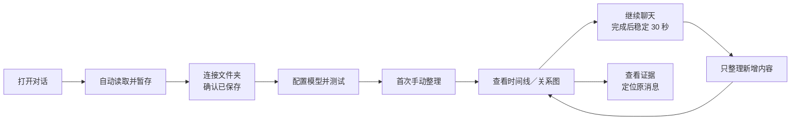

# Topic Atlas 产品需求文档（PRD）

文档版本：PRD 1.1 拆分评审稿。日期：2026-10-18。现状基线：v0.6.1。目标为下一版，尚未发布，未承诺日期。

面向产品、设计、业务评审和验收人员，回答“为什么做、为谁做、用户怎样用、应该表现成什么、怎样算完成”。系统实现、完整字段和接口见[技术设计文档](topic-atlas-technical-design.md)。两份共用需求与验收编号，不重复定义产品决策。

## 01 产品定位与目标

Topic Atlas 是浏览器中的个人对话整理工具：保留真实讨论，以知识主题组织多轮内容，让用户理解讨论路径、找到已确认结论和未解决问题，并回到原文核对。它不替代聊天平台，也不把每次问答机械变成主题。

目标：减少长对话回顾成本，表达主题的推进、分支与回归；让用户清楚区分建议、采纳、助手完成报告和真实反馈；增量整理降低重复等待和调用；数据能保存在用户指定文件夹并可靠恢复。

## 02 用户、问题与典型场景

| 用户 | 主要问题 | 成功体验 |
| --- | --- | --- |
| 个人研究者 | 主题散落、多次回归难梳理 | 从主题看演变、证据和未解决问题。 |
| 方案讨论者 | 建议、约束和决策混淆 | 看清谁提出、是否采纳、为何修改。 |
| 持续开发者 | 实现报告与失败反馈脱节 | 回顾需求、执行报告和后续反馈。 |
| 长对话回顾者 | 反复搜索、滚动和全文重整 | 从摘要或主题准确回到原消息。 |

日常旅程：首次完成保存与模型设置 → 手动整理一次 → 继续聊天后自动增量 → 切换页面继续工作 → 回看主题、轮次与证据。中断、文件夹失效和费用不确定时，应有可理解的状态与明确选择。

<!-- diagram:journey -->

## 03 版本范围与已确认决策

### 03.1 当前能力与主要差距

v0.6.1 已有自动读取、问答聚合、平台分支、两个视图、定位、人工标注、自选模型、提示词、分段与增量、后台任务和文件备份。当前仍主要从浏览器保存的数据运行，指定文件夹保存副本；中断后常需人工续做。下一版要求文件夹成为正式资料库，并在安全条件下自动恢复。

“已实现”是已有代码和基线检查，不代表所有真实账号都验证。“已有但需完善”保留现有能力并补齐体验与边界。“下一版新增”是目标要求。“远期候选”不作本轮承诺。

### 03.2 必须保持的边界

- 仅两个主视图：时间线列表、关系图；其他功能用辅助页面或弹层。
- 优先个人使用、Windows Edge＋ChatGPT；Gemini 继续标明实验限制。
- 文件夹为正式资料库，未连接时可暂存，但不开始新的 AI 归纳。
- 首次手动后才自动，默认回复完成并稳定 30 秒；有变化才整理。
- 切页和关闭侧栏不取消；请求结果未知、可能重复计费时先让用户确认。
- 保留用户选择的服务、提示词、人工标注、导出和原文追溯。
- 不编造原文、时间、附件内容、跳转链接或平台锚点。

### 03.3 本版不做

跨会话统一知识库、跨库语义搜索、多人协作、云同步、账号历史批量抓取、完整附件理解、多浏览器同时写同一库、永久清除与自动清理，均为远期候选。不据此扩大权限。

P0 是发布门槛，P1 是增强，若延期须明确说明。已有能力不因标为 P1 就可删除或回归。

## 04 页面结构与交互

| 区域 | 用户需要看到 | 用户可以做 |
| --- | --- | --- |
| 侧栏顶部 | 当前对话、路径、读取开关、模型目标 | 切换本机记录或路径、启动整理、进入设置。 |
| 时间线 | 轮次、主题标题、角色摘要、可用原时间、缺失提示 | 展开原文、定位、编辑、搜索命中。 |
| 关系图 | 主题与推进／分支／回归、推断与待更新状态 | 查看主题摘要、关系理由、轮次和证据。 |
| 状态条 | 采集、AI 整理、文件保存各自状态及全局任务数 | 打开任务和修复入口。 |
| 任务辅助页 | 对话、内容版本、模型、已完成与剩余、失败原因 | 取消、修复后续做、确认未知重试或放弃。 |
| 资料库设置 | 目录名称、授权、备注、上次成功保存 | 选择、更换、重授权、迁移、冲突处理、历史恢复。 |
| 模型与提示词 | 服务与模型、凭据状态、预算、测试结果 | 测试不保存，成功保存关闭设置框，失败原处显示。 |

## 05 核心业务规则与状态

### 05.1 三种完成不是一回事

“已采集”只表示内容被读取；“AI 已处理”表示模型与归纳环节已有结果；“已保存”只用于文件夹中完整保存并验证的内容。处理中可以看上次正式结果，但要标明是否待更新。错误不能让任务列表和恢复入口消失。

推荐文案：“已采集 23 轮，新增 3 轮暂存本机，请重新授权资料库”；“已保存 20／23 轮，上一段结果未知，重试可能再次计费”；“当前显示上次正式结果，新增内容正在整理”。

### 05.2 自动更新与费用

默认等待回复完成且内容稳定 30 秒。新内容重新计时，重复读取未变内容不计新变化。30 秒只是等待窗口，总耗时还包含发现内容、排队、模型和保存时间，不承诺 30 秒必出新图。可关闭自动或改为尽快整理，仍不在回复生成中启动。

已完成 20 轮后增加 3 轮，只处理新增；修改第 17 轮，从受影响处重整，前 16 轮有效结果保留。变更归纳模型或规则需要重新整理，只调预算不应丢进度。没有内容变化不调用模型。

### 05.3 中断、保存与恢复

未开始部分可自动继续；已经保存的结果不重复调用；请求可能已计费但结果未知时先确认。文件夹或凭据不可用时等待修复。取消阻止后续处理，不承诺撤销服务商费用。

文件夹迁移先复制检查再切换，失败保留原库。冲突保留双方并让用户选择，不能偷偷覆盖。恢复只改本地，先保留当前版并暂停自动整理；若网页读取仍开，须说明网页现状可能再次同步回来。

### 05.4 可信内容

主题是知识组织单位，轮次是讨论顺序，平台编辑版本不是主题关系。用户请求、AI 建议、用户确认、助手自报完成与用户失败反馈不能混淆。能看到原文证据不等于归纳结论必然正确，推断和缺失必须可见。

## 06 功能需求、优先级与关联

| 编号 | 优先级 | 现状分类 | 用户需求 | 验收 |
| --- | --- | --- | --- | --- |
| [TA-F001](#req-TA-F001) | P0 | 已有但需完善 | 首次使用引导 | AT-001 |
| [TA-F002](#req-TA-F002) | P0 | 已实现 | 自动读取当前对话 | AT-002 |
| [TA-F003](#req-TA-F003) | P0 | 已实现 | 用户、AI 与轮次展示 | AT-003 |
| [TA-F004](#req-TA-F004) | P0 | 已有但需完善 | 对话分支与历史版本 | AT-004 |
| [TA-F005](#req-TA-F005) | P0 | 已实现 | 时间线列表 | AT-005 |
| [TA-F006](#req-TA-F006) | P0 | 已实现 | 主题关系图 | AT-006 |
| [TA-F007](#req-TA-F007) | P0 | 已实现 | 定位原消息 | AT-007 |
| [TA-F008](#req-TA-F008) | P0 | 已有但需完善 | 人工主题与总结 | AT-008 |
| [TA-F009](#req-TA-F009) | P1 | 下一版新增 | 当前对话搜索 | AT-009 |
| [TA-F010](#req-TA-F010) | P0 | 已有但需完善 | 模型连接与设置 | AT-010 |
| [TA-F011](#req-TA-F011) | P0 | 已实现 | 归纳提示词 | AT-011 |
| [TA-F012](#req-TA-F012) | P0 | 已有但需完善 | 首次手动与后续自动整理 | AT-012 |
| [TA-F013](#req-TA-F013) | P0 | 已实现 | 长对话分段与预算 | AT-013 |
| [TA-F014](#req-TA-F014) | P0 | 已有但需完善 | 只整理新增和变更部分 | AT-014 |
| [TA-F015](#req-TA-F015) | P0 | 已有但需完善 | 切页仍继续整理 | AT-015 |
| [TA-F016](#req-TA-F016) | P0 | 已有但需完善 | 进度与正式结果 | AT-016 |
| [TA-F017](#req-TA-F017) | P0 | 下一版新增 | 安全自动恢复 | AT-017 |
| [TA-F018](#req-TA-F018) | P0 | 已有但需完善 | 取消、失败与续做 | AT-018 |
| [TA-F019](#req-TA-F019) | P0 | 下一版新增 | 文件夹为正式资料库 | AT-019 |
| [TA-F020](#req-TA-F020) | P0 | 已有但需完善 | 文件夹选择与授权 | AT-020 |
| [TA-F021](#req-TA-F021) | P0 | 下一版新增 | 迁移与冲突处理 | AT-021 |
| [TA-F022](#req-TA-F022) | P0 | 已有但需完善 | 历史版本恢复 | AT-022 |
| [TA-F023](#req-TA-F023) | P0 | 已有但需完善 | 清楚的采集、整理、保存状态 | AT-023 |
| [TA-F024](#req-TA-F024) | P0 | 已有但需完善 | 导出与可恢复删除 | AT-024 |
| [TA-F025](#req-TA-F025) | P0 | 已有但需完善 | 升级与回退 | AT-025 |
| [TA-F026](#req-TA-F026) | P0 | 已实现 | 证据与不确定性 | AT-026 |
| [TA-F027](#req-TA-F027) | P1 | 已有但需完善 | 诊断与隐私反馈 | AT-027 |
| [TA-F028](#req-TA-F028) | P1 | 已有但需完善 | 兼容性与可访问性 | AT-028 |
| [TA-N001](#req-TA-N001) | P0 | 下一版新增 | 正式数据完整性 | AT-029 |
| [TA-N002](#req-TA-N002) | P0 | 已有但需完善 | 访问与凭据保护 | AT-030 |
| [TA-N003](#req-TA-N003) | P1 | 下一版新增 | 长对话性能目标 | AT-031 |
| [TA-N004](#req-TA-N004) | P0 | 已有但需完善 | 预算与费用可理解 | AT-032 |
| [TA-N005](#req-TA-N005) | P0 | 下一版新增 | 恢复不重复收费 | AT-033 |
| [TA-N006](#req-TA-N006) | P0 | 下一版新增 | 发布与评审证据 | AT-034 |

### TA-F001 首次使用引导

**P0 · 已有但需完善 · AT-001**

首次使用按“选择保存文件夹、配置模型、测试连接、首次整理”完成设置。填写路径文字不代表已连接；暂存内容尚未正式保存时不能启动 AI 整理。保存设置成功后自动关闭窗口，失败留在原处说明原因。

对应：[技术方案](topic-atlas-technical-design.md#req-TA-F001)。

### TA-F002 自动读取当前对话

**P0 · 已实现 · AT-002**

打开支持的已保存对话即自动读取，无须点击采集或滚动全部历史。切换对话不能混入另一条内容。后台网页回到前台后补读，不批量遍历账号历史。

对应：[技术方案](topic-atlas-technical-design.md#req-TA-F002)。

### TA-F003 用户、AI 与轮次展示

**P0 · 已实现 · AT-003**

每轮最多显示一个合并用户节点和一个合并 AI 节点，并能查看原片段。未知角色明确标记；回复未完成可暂缺 AI；隐藏上下文不展示；附件未解析的内容不得编造。

对应：[技术方案](topic-atlas-technical-design.md#req-TA-F003)。

### TA-F004 对话分支与历史版本

**P0 · 已有但需完善 · AT-004**

平台编辑或重新生成的回答保存为不同路径。切换网页路径不改变已开始整理的内容；查看本地分支不擅自操作网页。不同分支的摘要、证据和结果分别保留。

对应：[技术方案](topic-atlas-technical-design.md#req-TA-F004)。

### TA-F005 时间线列表

**P0 · 已实现 · AT-005**

按所选路径的讨论顺序显示主题标题、用户与 AI 摘要、可用的真实时间、原文展开和定位入口。缺时间不补造；旧摘要与当前内容不一致时标为待更新。

对应：[技术方案](topic-atlas-technical-design.md#req-TA-F005)。

### TA-F006 主题关系图

**P0 · 已实现 · AT-006**

以知识主题组织多轮讨论，展示推进、分支和回归。点击主题查看摘要及对应轮次，点击关系查看理由和证据。没有依据不强行连线，同一主题回归不创建重复主题。

对应：[技术方案](topic-atlas-technical-design.md#req-TA-F006)。

### TA-F007 定位原消息

**P0 · 已实现 · AT-007**

从任一轮摘要或证据回到真实网页消息。成功后高亮；目标尚未加载时尝试查找。重复内容无法区分、原网页无权访问或查找失败时明确反馈，不跳到相似但错误的位置。

对应：[技术方案](topic-atlas-technical-design.md#req-TA-F007)。

### TA-F008 人工主题与总结

**P0 · 已有但需完善 · AT-008**

用户可修改主题名称、补充总结及关系，人工输入独立保留，并优先用于后续整理。修改影响的内容需要重新整理；无法满足的关系冲突必须提示，不能悄悄覆盖。

对应：[技术方案](topic-atlas-technical-design.md#req-TA-F008)。

### TA-F009 当前对话搜索

**P1 · 下一版新增 · AT-009**

在两个视图中查找所选路径已采集的原文、主题和摘要。命中显示轮次并可进入对应位置；清空恢复完整视图。不扩展为跨会话语义搜索，不新增第三主视图。

对应：[技术方案](topic-atlas-technical-design.md#req-TA-F009)。

### TA-F010 模型连接与设置

**P0 · 已有但需完善 · AT-010**

支持 OpenAI、Kimi、DeepSeek 和自定义兼容服务。各服务凭据分别管理，默认临时保留。连接测试只发简短测试，不发对话，也不自动保存；必须收到完整回复才算成功，并告知可能产生少量费用。

对应：[技术方案](topic-atlas-technical-design.md#req-TA-F010)。

### TA-F011 归纳提示词

**P0 · 已实现 · AT-011**

可调整主题粒度、摘要和关系规则，支持保存与恢复默认。原文追溯和结构要求不能被自定义规则取消。已开始任务保持创建时的规则，新设置只影响新任务。

对应：[技术方案](topic-atlas-technical-design.md#req-TA-F011)。

### TA-F012 首次手动与后续自动整理

**P0 · 已有但需完善 · AT-012**

每条对话首次手动抽取后才自动整理。默认等待 AI 回复完成、内容稳定 30 秒；可选择尽快整理、调整等待或关闭。新内容重新计时，重复读取未变内容不延后，也不重复调用。

对应：[技术方案](topic-atlas-technical-design.md#req-TA-F012)。

### TA-F013 长对话分段与预算

**P0 · 已实现 · AT-013**

长对话按完整轮次分段，默认每段最多 6 轮，输入与输出预算可调。无法容纳一整轮时说明原因，不截断原文或把一轮假拆为多轮。明确长度不足时允许有限调整重试。

对应：[技术方案](topic-atlas-technical-design.md#req-TA-F013)。

### TA-F014 只整理新增和变更部分

**P0 · 已有但需完善 · AT-014**

新增长度不影响已确认旧内容时，只处理新增讨论。修改旧轮次或人工标注，从受影响处更新。更换模型或归纳规则应重新整理；只调预算不丢已完成进度。

对应：[技术方案](topic-atlas-technical-design.md#req-TA-F014)。

### TA-F015 切页仍继续整理

**P0 · 已有但需完善 · AT-015**

开始整理后可切换对话、网页或关闭侧栏。任务继续处理当时选定内容；新增内容安排后续处理，并复用刚完成的有效进度。用户可从任务页找到其他对话的任务。

对应：[技术方案](topic-atlas-technical-design.md#req-TA-F015)。

### TA-F016 进度与正式结果

**P0 · 已有但需完善 · AT-016**

分段完成进度持续保存，全部整理完成且文件保存成功后才显示新正式结果。处理中可保留上次结果并标注状态；部分结果不得冒充完整新图。

对应：[技术方案](topic-atlas-technical-design.md#req-TA-F016)。

### TA-F017 安全自动恢复

**P0 · 下一版新增 · AT-017**

重启后安全进度自动恢复：未开始的部分继续，已保存结果不重复调用。若上次请求可能已处理但结果未知，先说明可能重复计费，由用户确认重试或放弃；目录或凭据不可用先等待。

对应：[技术方案](topic-atlas-technical-design.md#req-TA-F017)。

### TA-F018 取消、失败与续做

**P0 · 已有但需完善 · AT-018**

可取消，已完成进度保留，取消后不再启动新段；不承诺撤销服务商已产生费用。登录凭据、余额、限流、超时或结果错误应说明原因和修复动作，不反复自动尝试。

对应：[技术方案](topic-atlas-technical-design.md#req-TA-F018)。

### TA-F019 文件夹为正式资料库

**P0 · 下一版新增 · AT-019**

用户选定文件夹保存正式对话和整理结果，浏览器可在未连接时暂存。只有文件真正保存并验证后才显示已保存；未连接、授权失效或保存失败时暂停新 AI 整理，保留临时内容。

对应：[技术方案](topic-atlas-technical-design.md#req-TA-F019)。

### TA-F020 文件夹选择与授权

**P0 · 已有但需完善 · AT-020**

用户在设置中选择或新建文件夹，建议文档中的 Topic Atlas。路径文字只是备注，实际以授权选择为准。显示目录名称和授权状态；重新授权只用于已连接过的目录，不在后台突然弹授权。

对应：[技术方案](topic-atlas-technical-design.md#req-TA-F020)。

### TA-F021 迁移与冲突处理

**P0 · 下一版新增 · AT-021**

换文件夹先复制、检查再切换，失败保留原目录和暂存。已有资料重复时不无谓复制，冲突时保留双方并让用户决定。不同资料库由用户选择切换或导入，不静默合并；本版不支持多浏览器同时写同库。

对应：[技术方案](topic-atlas-technical-design.md#req-TA-F021)。

### TA-F022 历史版本恢复

**P0 · 已有但需完善 · AT-022**

可查看和恢复历史版本，恢复前保留当前版本。损坏或未保存完整的版本不能覆盖当前内容。恢复只影响本地，不修改平台；恢复后暂停该对话自动整理，并提示网页自动读取仍可能带回现状。

对应：[技术方案](topic-atlas-technical-design.md#req-TA-F022)。

### TA-F023 清楚的采集、整理、保存状态

**P0 · 已有但需完善 · AT-023**

分别显示已采集、AI 处理进度和文件保存结果。辅助页显示对话、内容版本、模型、剩余轮数、失败原因及恢复动作；不同阶段耗时分开，错误不遮住任务和恢复入口。

对应：[技术方案](topic-atlas-technical-design.md#req-TA-F023)。

### TA-F024 导出与可恢复删除

**P0 · 已有但需完善 · AT-024**

默认导出整条已保存本地记录，说明包含其他已读分支与分析历史。删除前解释对任务、采集、缓存和文件历史的影响；取消相关任务、暂停采集，文件备份保留可恢复。本版不提供永久清除。

对应：[技术方案](topic-atlas-technical-design.md#req-TA-F024)。

### TA-F025 升级与回退

**P0 · 已有但需完善 · AT-025**

升级前保存旧资料和安装版本，先复制检查，成功才切换。不能证明适用的旧结果保留为历史，不冒充最新；旧任务未经核对不自动运行。新格式不被旧版直接误用，可回到旧备份。

对应：[技术方案](topic-atlas-technical-design.md#req-TA-F025)。

### TA-F026 证据与不确定性

**P0 · 已实现 · AT-026**

轮次和关系能查看对应消息及真实连续摘录，角色和来源必须一致；不得改数字、否定或拼接原文。明确区分推断，标出部分历史、附件缺失、角色未知；校验通过不代表语义一定正确。

对应：[技术方案](topic-atlas-technical-design.md#req-TA-F026)。

### TA-F027 诊断与隐私反馈

**P1 · 已有但需完善 · AT-027**

可主动复制不含正文、标题、会话地址、凭据的诊断，用于排查版本、采集和定位问题。默认不上传使用数据。普通错误不回显敏感服务响应；用户原文中的敏感内容不属于自动脱敏承诺。

对应：[技术方案](topic-atlas-technical-design.md#req-TA-F027)。

### TA-F028 兼容性与可访问性

**P1 · 已有但需完善 · AT-028**

主要验收 Windows Edge＋ChatGPT，支持版本以实际记录为准。Gemini 明示实验性，未知回复完成状态不自动触发。窄侧栏、键盘、可见焦点和文字状态可用，不只依靠颜色。

对应：[技术方案](topic-atlas-technical-design.md#req-TA-F028)。

### TA-N001 正式数据完整性

**P0 · 下一版新增 · AT-029**

任何阶段中断后，不丢失已经正式保存的内容；未完整保存的数据不能标已保存。可安全恢复的资料应能找回，不能以看似成功的提示掩盖损坏或缺失。

对应：[技术方案](topic-atlas-technical-design.md#req-TA-N001)。

### TA-N002 访问与凭据保护

**P0 · 已有但需完善 · AT-030**

普通网页不能读取配置凭据、私有归档或启动付费整理／目录操作。合法插件设置页可正常操作。只请求必要权限，自选服务访问需授权，配置凭据不得出现在导出和诊断中。

对应：[技术方案](topic-atlas-technical-design.md#req-TA-N002)。

### TA-N003 长对话性能目标

**P1 · 下一版新增 · AT-031**

待验证目标：约 1000 轮、2MB 文本时，本地已缓存首屏不超过 2 秒，主要操作反馈 P95 不超过 200ms；网络和文件保存另行统计。大内容不能卡死或靠丢原文提速。

对应：[技术方案](topic-atlas-technical-design.md#req-TA-N003)。

### TA-N004 预算与费用可理解

**P0 · 已有但需完善 · AT-032**

明确区分估算用量和服务商实际返回用量，显示已处理、复用与预计工作量。缺数据不显示为零；失败和未知请求单列，不能把请求数冒充账单或承诺未核实的价格与节省。

对应：[技术方案](topic-atlas-technical-design.md#req-TA-N004)。

### TA-N005 恢复不重复收费

**P0 · 下一版新增 · AT-033**

重复打开、唤醒或点击不会并发重复处理同一部分。已保存的结果不重复发给服务；请求结果不确定时默认等待用户确认，取消或放弃应被尊重。

对应：[技术方案](topic-atlas-technical-design.md#req-TA-N005)。

### TA-N006 发布与评审证据

**P0 · 下一版新增 · AT-034**

需求、文案、设置默认值及验收保持一致。区分自动模拟验证、真实登录页面和真实付费服务验证；旧版通过记录不能当下一版证明。全部 P0 有证据，未测和顺延项明确，且可回退。

对应：[技术方案](topic-atlas-technical-design.md#req-TA-N006)。

## 07 质量、隐私与默认设置

用户能键盘使用，窄侧栏可操作，有文字状态和可见焦点。用户原文不静默丢失；错误提示给出动作，不只显示代码。配置凭据不进入导出和诊断；用户自己写入原文的敏感内容不保证自动脱敏。默认不上传使用统计，记住凭据须主动选择并说明当前本机存储未加密。

性能是待验证目标：1000 轮、约 2MB 本地内容，缓存首屏目标 2 秒内，主要操作反馈 P95 目标 200ms 内；网络与磁盘另统计。不能把目标写成实测结果，也不为性能丢原文。

| 设置 | 默认／用户范围 | 解释 |
| --- | --- | --- |
| 自动读取 | 开启 | 仅实际打开的支持会话，不批量遍历账号。 |
| 自动整理 | 每条对话首次手动后启用 | 恢复本地历史会暂停该对话自动整理。 |
| 触发方式 | 稳定等待 30 秒 | 可选尽快／关闭，等待 5—3600 秒。 |
| 记住凭据 | 关闭 | 主动选择后才保留在本机。 |
| 每段轮数 | 最多 6 轮，可设 1—12 | 实际段可更小，保持完整问答。 |
| 输入／输出预算 | 默认分别 12000 Token | 输入为估算，实际能力以所选服务为准。 |
| 结果复用 | 开启 | 自动任务优先复用有效旧结果。 |

## 08 产品验收场景

下表是下一版要执行的验收，不是本次文档拆分已通过的产品测试。技术故障注入、接口检查与恢复阶段详见[技术设计文档的测试计划](topic-atlas-technical-design.md#technical-testing)。

| 验收 | 需求 | 用户场景与操作 | 可观察通过条件 |
| --- | --- | --- | --- |
| AT-001 | TA-F001 | 全新使用者填写路径，再选择文件夹、配置模型并保存。 | 单填路径不显示连接成功；首次未选目录不能点重新授权；完成保存后能首次整理，失败时有可执行的提示。 |
| AT-002 | TA-F002 | 在两条对话之间切换，并返回曾在后台继续更新的对话。 | 记录归属正确；回前台后补齐已返回内容；没有未经选择的账号历史批量采集。 |
| AT-003 | TA-F003 | 同一次问答被平台拆成多个片段，另有图片和未知角色内容。 | 同轮不重复拆卡；原片段可追溯；角色未知和附件缺失准确提示。 |
| AT-004 | TA-F004 | 路径 A 正在整理时，用户将网页切换到回答不同的路径 B。 | A 继续处理原内容，B 不混入 A；两条路径都能回看，旧结果不丢失。 |
| AT-005 | TA-F005 | 查看包含缺失时间、原文变更和人工标注的对话。 | 顺序准确，缺失可见，原文能展开，旧结果不会标为最新。 |
| AT-006 | TA-F006 | 讨论从架构转向竞品，再回到已有架构主题。 | 已有主题复用，回归方向正确，节点与连线均能追到原文。 |
| AT-007 | TA-F007 | 分别定位已加载、未加载、重复及不可访问的消息，中途取消一次。 | 成功定位正确，失败和取消原因清楚；无真实消息锚点时仍可查看本地轮次与摘录。 |
| AT-008 | TA-F008 | 用户修改某轮主题、写入补充总结，再整理并继续修改。 | 人工内容可找回；受影响部分更新；冲突可理解且可调整。 |
| AT-009 | TA-F009 | 其他分支有相同关键词，用户搜索当前路径的词及主题名。 | 只返回所选路径已存在内容；无结果说明范围，点击与清空行为正确。 |
| AT-010 | TA-F010 | 用错误凭据、空回复和有效模型分别测试，保存后更换服务地址。 | 显示清晰结果和所测模型；测试不发送对话；保存成功关闭框；不向新服务错用旧凭据。 |
| AT-011 | TA-F011 | 已有任务运行时修改提示词，对话中另含指令性文字。 | 旧任务结果不因中途设置改变而混乱；新任务使用新规则；原对话中的指令不被当作执行要求。 |
| AT-012 | TA-F012 | 首次整理前后持续聊天，生成中、完成后和等待中新增消息。 | 首次前及生成中不自动调用；新内容重置等待；不变内容不调用；自动跟随网页当前路径。 |
| AT-013 | TA-F013 | 整理 13 轮短对话并单独处理一轮超长内容。 | 预算足够时分三段；超长单轮明确停止；费用及分段次数有说明，不无限重试。 |
| AT-014 | TA-F014 | 已完成 20 轮后新增 3 轮，再修改第 17 轮。 | 新增仅处理 21—23 轮；不变零调用；修改后保留前 16 轮有效结果，不带入后续错误事实。 |
| AT-015 | TA-F015 | 旧内容整理中新增内容，随后切到另一对话。 | 原任务继续，不串对话、不丢新内容；新任务不无谓重复已完成部分。 |
| AT-016 | TA-F016 | 第二段已处理但保存失败，用户查看关系图并恢复目录。 | 能区分旧正式图和未完成新结果；已保存进度保留；不假报全部完成。 |
| AT-017 | TA-F017 | 在发送前、发送后无结果、结果已保存和全部完成时分别中断。 | 安全部分自动继续；已保存部分零重发；未知部分不擅自收费重试且有明确选择。 |
| AT-018 | TA-F018 | 整理中取消，并分别模拟凭据、限流、超时、证据错误。 | 无无限重试；能看到保留进度并修复后续做；未知请求继续遵守确认规则。 |
| AT-019 | TA-F019 | 撤销目录权限后继续聊天，再点整理并重新授权。 | 显示待保存而不是成功；暂存不丢、归纳不启动；同步成功后恢复安全任务。 |
| AT-020 | TA-F020 | 首次填备注、选择目录，再让授权失效。 | 填写备注不冒充连接；未选目录时重新授权不可点；失效有明确恢复入口。 |
| AT-021 | TA-F021 | 目标有重复和冲突资料，迁移中途失败，另有外部更改。 | 不静默覆盖；失败后原库仍可用；冲突可查看和导出；发现外部变化时暂停处理。 |
| AT-022 | TA-F022 | 恢复有效、损坏及未保存完整的历史记录。 | 有效恢复且当前版可找回；损坏拒绝；恢复后不自动调用模型。 |
| AT-023 | TA-F023 | API 已回复但保存失败，其他对话另有任务。 | 用户可判断哪部分完成、哪部分未保存，并找到全部任务和下一步动作。 |
| AT-024 | TA-F024 | 有分支、历史和运行任务的记录先导出，再删除和恢复。 | 导出范围准确且不含配置凭据；删除不被后台自动复活；历史仍可恢复。 |
| AT-025 | TA-F025 | 用旧资料升级、失败回退，并遇到不支持的新格式。 | 原数据可找回，数量与内容核对；不支持时清楚拒绝，不破坏目录或盲目收费。 |
| AT-026 | TA-F026 | 正确证据、排版差异、数字改写、跨消息拼接及缺角色内容。 | 合法差异还原真实原文；改写和拼接不能发布；不确定性保留，推断不冒充核实。 |
| AT-027 | TA-F027 | 在测试原文和服务错误中放入敏感标记，再复制诊断和导出。 | 诊断与错误不泄露；明确对话导出仍包含用户原文，配置凭据单独保护。 |
| AT-028 | TA-F028 | 在窄侧栏和键盘模式使用视图、设置与证据，并读取实验来源。 | 主操作无整页横向溢出，可键盘完成；能力限制清楚，未知完成不自动调用。 |
| AT-029 | TA-N001 | 在不同保存阶段中断后重新打开。 | 最后完整版本可用；未完整版本有明确处理状态，不覆盖好数据。 |
| AT-030 | TA-N002 | 合法设置、普通网页和其他扩展分别尝试敏感操作。 | 合法可用，未授权来源拒绝且不泄露凭据；不会因设置页形式误拦。 |
| AT-031 | TA-N003 | 记录机器和浏览器，使用长对话及 100 主题夹具重复至少 20 次。 | 报告样本、耗时和瓶颈；未实测或未达标不写成通过，完整性优先。 |
| AT-032 | TA-N004 | 查看正常、限流、未知结果及无用量返回的任务。 | 用户理解哪些是估算、哪些缺失、何时可能重复费用；没有无限自动调用。 |
| AT-033 | TA-N005 | 多阶段中断并多次唤醒或重复确认。 | 安全部分只处理一次；一次确认不引出多次新尝试；不保证服务商侧一定不重复计费。 |
| AT-034 | TA-N006 | 对候选版本进行需求核对、回归和回退演练。 | 每条 P0 对应通过证据，未实测如实列出，旧资料和版本可恢复。 |

## 09 成功指标与发布标准

衡量用户能否从主题回到原文、无变化是否零调用、保存状态是否准确、中断是否保留有效进度，以及不确定费用是否先确认。不编造采集成功率、节省比例或真实用户效果。

本地记录处理／剩余轮数、复用情况、请求尝试、实际服务用量、保存失败与定位结果。未返回用量不算零，估算不是账单，默认不上传统计。

所有 P0 有验收证据，P1 延期明确；默认值、文案与两份文档一致；真实登录页和付费服务验证分别记录；保留旧版和资料备份并完成回退演练。既有 140 项自动检查只是 v0.6.1 基线，不能当作下一版通过。

## 10 风险与边界

平台变化可能使读取或定位失效，需提示与诊断；浏览器关闭期间不运行；文件夹权限、空间或外部改动可导致保存失败；模型语义可能有偏差；有限上下文可能遗漏远距离关系。不能以“已连接”“已回复”代替“资料已保存”，不能承诺未知请求不收费。

真实账号、模型和性能矩阵尚需实测。问题无法满足既定产品底线时重新评审，不让开发自行降低“不静默覆盖、不假报保存、不无提示重复调用”的要求。

## 11 文档关系与维护

本 PRD 定义目标、场景、交互、业务规则与可观察验收；[技术设计文档](topic-atlas-technical-design.md)定义实现架构、完整字段、接口、存储、恢复和工程测试。需求编号 TA-F／TA-N、验收编号 AT 沿用混合稿，技术方案按同编号回链。

文档版本 1.1 表示内容拆分，不是插件升级。Markdown 是源文件，HTML 为同源离线阅读版。业务决策变更先改 PRD，再评估技术方案与验收影响。原混合稿已在工作目录保留备份。
