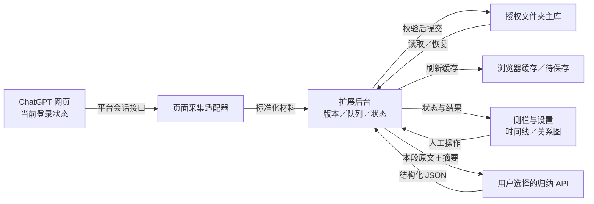
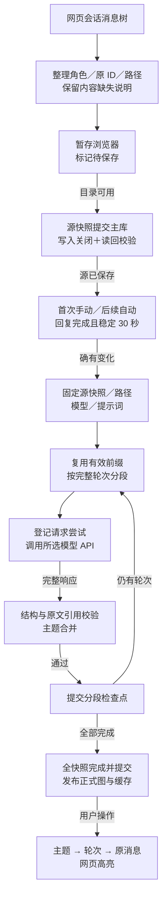
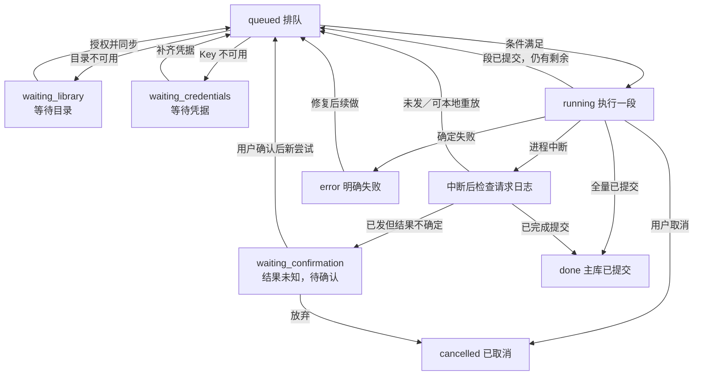
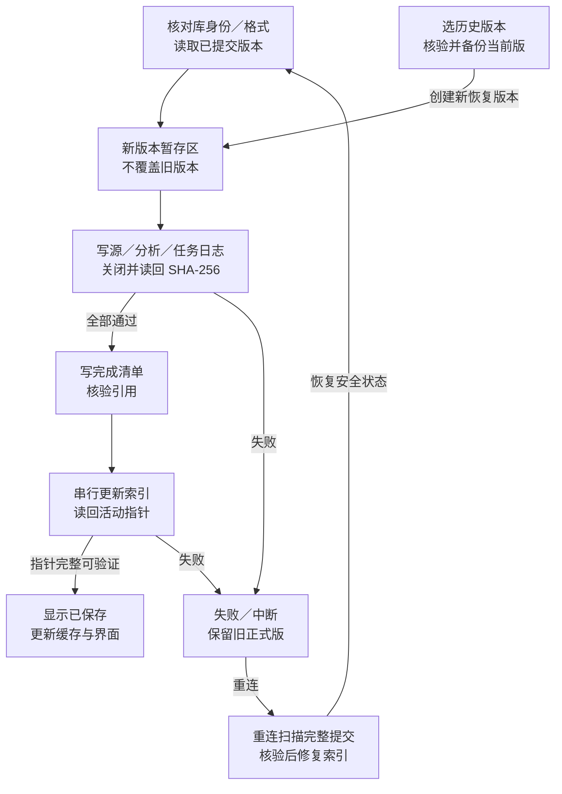

# Topic Atlas 技术设计文档

文档版本：TDD 1.1 拆分评审稿。日期：2026-10-18。现状基线：v0.6.1；下一版设计尚未实现，不是生产验证结果。

面向开发、测试及技术评审。本文回答“如何实现”，[PRD](topic-atlas-prd.md)是产品目标与业务规则的权威来源。两份共同使用 34 项需求和 34 组验收编号，本次只拆文档，不改插件。

## 01 设计输入、现状与非目标

实现输入是已确认的文件夹正式主库、安全自动恢复、两个主视图、默认 30 秒、自选模型和证据可追溯。保持浏览器扩展形态，不引入云同步、SQL、向量库、多用户协作或多浏览器并发写库。

现状 v0.6.1 的浏览器存储为运行主数据，目录为副本；后台进程重建通常标中断待人工续做；恢复文件不会自动恢复任务队列。旧内容指纹为非加密 32 位哈希，文件校验为 SHA-256。current 是可变路径别名，不能当永久版本。下一版字段和请求日志是规划，不是当前已有能力。

## 02 模块职责与依赖

| 子系统 | 职责与数据 | 关键约束 |
| --- | --- | --- |
| 网页采集适配 | 当前登录页面读取、标准化原消息与路径 | 只采实际打开的会话；令牌不返回归档。 |
| 后台协调 | 串行处理、源版本、任务领取与恢复 | 不依赖侧栏长请求；固定任务来源。 |
| 主库与版本 | 源、标注、图、检查点、请求日志和索引 | 提交验证后才公布保存成功。 |
| 浏览器缓存 | 界面索引、待提交内容与恢复暂存 | 可重建，不冒充正式主库。 |
| 分段与模型调用 | 有效前缀、相关上下文、预算与有限重试 | 每次尝试登记；凭据单独取得。 |
| 结构与证据校验 | 轮次、角色、原文、关系方向与人工标注 | 结构合法不代表语义核实。 |
| 侧栏与辅助设置 | PRD 定义的两个主视图及状态操作 | 受信页面可操作，网页不能付费或读凭据。 |
| 定位适配 | 实际地址、原 ID、片段和路径上下文 | 有限搜索、歧义不误跳、用户可取消。 |

## 03 需求到技术方案追踪

下列保留原混合稿的实现约束，具体用户体验与验收表述以对应 PRD 为准；产品范围不由本文擅自扩大。

### TA-F001 首次使用引导：实现约束

对应 [PRD TA-F001](topic-atlas-prd.md#req-TA-F001) · P0 · AT-001。

引导顺序为选择资料库、配置 API、独立测试、首次抽取。填路径仅作备注，不能授权；没有目录句柄时禁用重新授权。网页内容可暂存，源快照未提交主库前不得发归纳请求。合法设置标签页即使带 sender.tab 也不能被误拦。

### TA-F002 自动读取当前对话：实现约束

对应 [PRD TA-F002](topic-atlas-prd.md#req-TA-F002) · P0 · AT-002。

主支持为 Edge＋ChatGPT，仅读取实际打开的已保存会话，不遍历账号历史。可见页面变化触发并节流约 15 秒；后台页重新可见后补读。结果保存前校验真实页面归属，切页不能串写。

### TA-F003 用户、AI 与轮次展示：实现约束

对应 [PRD TA-F003](topic-atlas-prd.md#req-TA-F003) · P0 · AT-003。

结构化角色优先，连续用户片段合为一个 You，同轮助手片段合为一个 AI，保留原片段 ID。未知角色不猜；未完成轮次允许缺 AI。过滤隐藏系统与内部分析；媒体只标缺失和可用文字，不推测附件正文。

### TA-F004 对话分支与历史版本：实现约束

对应 [PRD TA-F004](topic-atlas-prd.md#req-TA-F004) · P0 · AT-004。

平台编辑／重生成路径和语义主题分支分开。current 只作 UI 别名；任务绑定不可变 branchVersionId、snapshotId。查看本机路径不自动切网页版本；完全相同的旧路径可找回匹配结果。

### TA-F005 时间线列表：实现约束

对应 [PRD TA-F005](topic-atlas-prd.md#req-TA-F005) · P0 · AT-005。

按所选路径顺序显示主题标题、用户／AI 摘要、可用真实时间、展开原文和定位入口。数字序号不是永久 ID；缺平台时间不以采集时间冒充。旧结果与当前快照不符时标过期。

### TA-F006 主题关系图：实现约束

对应 [PRD TA-F006](topic-atlas-prd.md#req-TA-F006) · P0 · AT-006。

多轮同一问题归为主题；关系仅 flow 推进、branch 语义分支、return 回归。可看节点摘要、轮次、关系原因与推断标记。无依据不连线，无同主题自连接；不能把平台版本分叉直接算语义分支。

### TA-F007 定位原消息：实现约束

对应 [PRD TA-F007](topic-atlas-prd.md#req-TA-F007) · P0 · AT-007。

按真实会话地址打开／聚焦网页，先原 ID 后原文与路径上下文匹配。未渲染目标有限次加载，高亮正确消息；歧义不任意跳转。用户操作可取消，失败恢复原滚动位置。无真实锚点时用轮次摘录，不造链接。

### TA-F008 人工主题与总结：实现约束

对应 [PRD TA-F008](topic-atlas-prd.md#req-TA-F008) · P0 · AT-008。

人工名称、归类、补充总结和关系优先保留。名称与关系进入校验，补充总结独立可见并作为输入。改变标注使受影响分析失效；冲突需反馈，AI 不得静默抹掉人工输入。

### TA-F009 当前对话搜索：实现约束

对应 [PRD TA-F009](topic-atlas-prd.md#req-TA-F009) · P1 · AT-009。

两个主视图共用轻量搜索，只查所选对话路径的已采集原文、主题和摘要；命中显示轮次并可进入时间线／主题。不增加第三主视图，不扩展为跨会话语义搜索。

### TA-F010 模型连接与设置：实现约束

对应 [PRD TA-F010](topic-atlas-prd.md#req-TA-F010) · P0 · AT-010。

支持 OpenAI、Kimi、DeepSeek、自定义 HTTPS 兼容服务。Key 按服务／origin 隔离，默认临时，记住需主动选择并告知当前本地未加密。测试用表单模型独立简短请求，不发对话、不自动保存；200 不算成功，需完整非空回复，JSON 模式还须对象可解析。

### TA-F011 归纳提示词：实现约束

对应 [PRD TA-F011](topic-atlas-prd.md#req-TA-F011) · P0 · AT-011。

可编辑、保存和恢复归纳提示词，但结构、分段、引用契约不可取消。任务固定提示词文本与规则签名，新设置只影响新任务。对话中的指令、代码、附件描述只作材料。

### TA-F012 首次手动与后续自动整理：实现约束

对应 [PRD TA-F012](topic-atlas-prd.md#req-TA-F012) · P0 · AT-012。

每条对话首次手动抽取后开启自动资格。默认 idle 30 秒，另有 immediate／off；可设 5—3600 秒。明确回复完成才计时；内容或标注变更重置，重复采集时间不重置。自动跟随网页当前路径，手动可指定路径。

### TA-F013 长对话分段与预算：实现约束

对应 [PRD TA-F013](topic-atlas-prd.md#req-TA-F013) · P0 · AT-013。

默认最多 6 轮、估算输入 12000、最大输出 12000 Token，可配置。预算不等于真实模型窗口。按完整轮次切分；明确超限／输出截断最多缩小 4 次。单轮仍超限则停止，不能截断或把一轮伪造为多轮。

### TA-F014 只整理新增和变更部分：实现约束

对应 [PRD TA-F014](topic-atlas-prd.md#req-TA-F014) · P0 · AT-014。

只追加轮次则复用有效前缀；旧正文、角色、媒体或标注变化从首个影响轮次重建。模型、地址、JSON 模式、提示词改变重新整理；仅预算改变保留有效进度。裁剪旧结果时不带入后续事实。

### TA-F015 切页仍继续整理：实现约束

对应 [PRD TA-F015](topic-atlas-prd.md#req-TA-F015) · P0 · AT-015。

API 段全局串行，任务固定对话、源、分支版本、模型及提示词。切页、关侧栏不取消。新增快照排旧任务之后，执行前吸收刚完成的有效前缀；旧任务不能覆盖实时新源。

### TA-F016 进度与正式结果：实现约束

对应 [PRD TA-F016](topic-atlas-prd.md#req-TA-F016) · P0 · AT-016。

每段结构和证据校验后先提交主库检查点，再更新缓存；全快照完成且正式提交成功后才发布新图。旧正式图可以标过期保留；部分结果只能标草稿／处理中。

### TA-F017 安全自动恢复：实现约束

对应 [PRD TA-F017](topic-atlas-prd.md#req-TA-F017) · P0 · AT-017。

未发送段自动续做；可靠完整响应已持久保存则本地重做校验与提交；已提交段复用。请求发出但无可靠结果的段进入待确认，明确可能重复计费后才能重试。目录／Key 未就绪先等待。

### TA-F018 取消、失败与续做：实现约束

对应 [PRD TA-F018](topic-atlas-prd.md#req-TA-F018) · P0 · AT-018。

取消阻止新段、尽力中止当前请求，不承诺撤销费用；已提交进度保留。认证、余额、限流、超时、拒绝与无效结构停止，不无限重试。已知引用错误最多校正一次，仍错则等用户处理。

### TA-F019 文件夹为正式资料库：实现约束

对应 [PRD TA-F019](topic-atlas-prd.md#req-TA-F019) · P0 · AT-019。

目录为正式数据源，浏览器为工作缓存和未提交暂存。只有完成写入、读回校验与活动索引核对才称已保存。未连库、撤权、写盘失败仍可采集暂存，但阻止新归纳请求，不把缓存成功当落盘成功。

### TA-F020 文件夹选择与授权：实现约束

对应 [PRD TA-F020](topic-atlas-prd.md#req-TA-F020) · P0 · AT-020。

用户手势选择并授权目录，建议当前用户文档下 Topic Atlas，本用户为 C:\Users\chen\Documents\Topic Atlas。备注不代表真实路径验证；显示句柄名和读写状态。后台不擅自弹授权框，未选目录禁用重授权。

### TA-F021 迁移与冲突处理：实现约束

对应 [PRD TA-F021](topic-atlas-prd.md#req-TA-F021) · P0 · AT-021。

连接前识别 libraryId／schemaVersion。不同库由用户选切换或导入副本；同源同版本内容相同去重，不同保留双方并标冲突。迁移全量复制校验后才切主库，失败保留原库和缓存。单库单写者，不支持跨浏览器并发。

### TA-F022 历史版本恢复：实现约束

对应 [PRD TA-F022](topic-atlas-prd.md#req-TA-F022) · P0 · AT-022。

数据文件关闭并读回哈希核验，再完成标记和索引。恢复前备份当前正式版本，核验历史后创建新的恢复版本；不修改平台消息。恢复后暂停会话自动整理，提示自动采集可能再同步网页现状。

### TA-F023 清楚的采集、整理、保存状态：实现约束

对应 [PRD TA-F023](topic-atlas-prd.md#req-TA-F023) · P0 · AT-023。

采集、归纳、落盘分别展示。侧栏显示当前会话及全局任务数；辅助页有源版本、模型、完成／剩余轮数、原因和恢复动作。区分稳定窗、排队、请求和保存耗时；错误不能隐藏恢复控件。

### TA-F024 导出与可恢复删除：实现约束

对应 [PRD TA-F024](topic-atlas-prd.md#req-TA-F024) · P0 · AT-024。

默认沿用整条本机记录导出，明确包含其他已读路径及分析历史。删除需说明取消任务、缓存、采集和历史的影响；沿用可恢复删除，文件历史保留。永久清除不在本版，不允许背景写入把已删活动记录复活。

### TA-F025 升级与回退：实现约束

对应 [PRD TA-F025](topic-atlas-prd.md#req-TA-F025) · P0 · AT-025。

旧 v1 格式先备份，只复制迁移至规划 schemaVersion 2，不破坏原库。原文标注路径优先迁移；分析须证明来源规则一致才复用，否则标历史过期。旧任务先核验请求确定性；未知未来格式拒绝写。

### TA-F026 证据与不确定性：实现约束

对应 [PRD TA-F026](topic-atlas-prd.md#req-TA-F026) · P0 · AT-026。

证据需有真实轮次、原消息、匹配角色和单条消息连续原文。允许有限空白／排版差异并恢复原片段；不改数字否定、不拼接。推断标 inferred，不造置信度；部分历史、未知角色和附件缺失保留 warnings。

### TA-F027 诊断与隐私反馈：实现约束

对应 [PRD TA-F027](topic-atlas-prd.md#req-TA-F027) · P1 · AT-027。

诊断仅版本、来源、结构计数、状态码、定位结果，不含原文、标题、会话地址、Key、登录令牌。主动复制、本地保存，不默认上传遥测；原始错误响应不得直接显示。用户原文本身的敏感内容不属于自动脱敏承诺。

### TA-F028 兼容性与可访问性：实现约束

对应 [PRD TA-F028](topic-atlas-prd.md#req-TA-F028) · P1 · AT-028。

发布主验收为 Windows Edge＋ChatGPT；最低基线沿用 Chromium 120。Gemini 明示实验，不承诺同等自动完成识别；Chrome 只列真实测过版本。主视图、设置支持键盘、可见焦点、文字状态和窄侧栏。

### TA-N001 正式数据完整性：实现约束

对应 [PRD TA-N001](topic-atlas-prd.md#req-TA-N001) · P0 · AT-029。

源、图、检查点和活动版本可相互核对。单实例串行，不假设多个文件全体原子更新。各写入边界中断，只展示最后完整提交或可核验的恢复版本；半写不能正式发布。

### TA-N002 访问与凭据保护：实现约束

对应 [PRD TA-N002](topic-atlas-prd.md#req-TA-N002) · P0 · AT-030。

网页最小权限，API origin 按需授权。内容脚本不可读凭据／私档，不可发付费任务或目录操作。校验浏览器提供的扩展 ID 和顶层真实 UI URL，合法设置页带 tab 仍可用。Key 不入任务、资料库、导出或诊断。

### TA-N003 长对话性能目标：实现约束

对应 [PRD TA-N003](topic-atlas-prd.md#req-TA-N003) · P1 · AT-031。

待验证目标：记录硬件和浏览器版本，以 1000 轮约 2MB 文本测缓存首屏≤2 秒，控制反馈 P95≤200ms；外部 API 和磁盘耗时分列。大图渐进绘制，不删原文换性能。

### TA-N004 预算与费用可理解：实现约束

对应 [PRD TA-N004](topic-atlas-prd.md#req-TA-N004) · P0 · AT-032。

区分估算输入、段上限、预计段数、复用轮数和实际 usage。缺 usage 显示未返回，不写 0。失败／未知请求单列，请求计数不是精确账单，不臆测价格；自动全局串行，不对限流无限重试。

### TA-N005 恢复不重复收费：实现约束

对应 [PRD TA-N005](topic-atlas-prd.md#req-TA-N005) · P0 · AT-033。

每次尝试先持久化 attemptId、段范围、输入指纹。已发无持久结果不能默认免费重试；浏览器关停、工作进程回收和临时 Key 丢失使用统一恢复。不能依赖 UI 长请求或仅内存定时器。

### TA-N006 发布与评审证据：实现约束

对应 [PRD TA-N006](topic-atlas-prd.md#req-TA-N006) · P0 · AT-034。

区分模拟夹具、真实登录页、真实付费 API 验证；已有 140 项仅为 v0.6.1 基线，不替代新增主库／恢复测试。默认值、字段版本、权限和文案一致，保留旧包及 v1 原库，完成回滚演练。

## 04 架构与数据流

### 04.1 两条独立外部链路

采集链路使用已登录平台页面读取当前会话；归纳链路由受信扩展后台使用用户配置的 API。平台登录令牌只在页面函数临时使用，不返回扩展归档或归纳服务。网页订阅不替代 API 凭据。

<!-- diagram:system -->

### 04.2 采集、提交、归纳与定位

采集材料为平台实际返回的可展示正文和结构；不是完整保留平台原始响应，不保证拥有未返回或已删除版本。源先提交主库，再启动付费归纳。

<!-- diagram:data -->

发送内容限定：可编辑规则与固定契约、本段原文／角色／ID、对应人工标注、knownGaps、有限旧主题与近两轮摘要。配置 Key 只用于认证，不作为归纳正文；对话 URL、完整任务归档和平台登录令牌不放进 user JSON。

模型输出结构化主题、时间线、关系和缺失说明。插件负责来源校验、合并、保存和绘图，不让模型生成浏览器操作、SVG 坐标或虚假链接。

## 05 分段、引用与失效算法

### 05.1 分段与上下文

保持整轮，不为预算把问答拆成假轮次。默认每段最多 6 轮，还受输入估算与输出预算约束。上下文最多 24 个旧主题摘要及最近两轮摘要，当前按文字相关性选择，不是向量检索。分段减少单次峰值，不保证首次总 Token 更少，也可能遗漏远距离关系。

有限缩段最多 4 次，仅用于明确超限／输出截断；已知证据错误最多校正一次。认证、余额、限流、超时等不无限重试。每个真实重试都登记新的网络尝试。

### 05.2 内容质量

- 用户请求不等于已经实现；AI 建议不等于用户采纳；助手自报完成须保留来源语气，用户失败反馈不可抹掉。
- 有正文的轮次须有主要主题与证据；有对应角色正文才有该角色摘要，缺少则 null，未知不猜交替。
- from 主题此前出现，to 属于目标轮次，return 目标更早出现；不自连、不重复、不强行连通。
- 证据和图须绑定同一源快照；短引用只辅助，保存还原为真实消息 ID 和原片段。
- 人工名称、归属与关系优先，人工总结独立保留；无法满足时明确提示，不静默覆盖。
- 校验只证明结构和文本来源，不保证语义正确；inferred 不是置信度。

### 05.3 复用与失效矩阵

| 变化 | 处理 |
| --- | --- |
| 仅采集更新时间 | 不重置稳定等待，不发 API。 |
| 追加完整轮次 | 复用有效前缀，只发新增正文。 |
| 原文、角色、媒体或标注变化 | 从首个受影响轮次重建并保留旧版。 |
| current 改路径 | 新路径版本，旧任务与图不变。 |
| 模型、地址、JSON 模式或提示词 | 新任务使用新规则，不混不兼容结果。 |
| 只调预算／输出长度 | 保留有效检查点。 |
| 同 origin 更新有效 Key | 不改变语义签名，执行时单独取得合法凭据。 |
| 旧条目来源不可验证 | 保留为历史并标过期，不直接发布为当前图。 |

## 06 后台状态与恢复决策

<!-- diagram:task -->

任务状态和请求状态是不同维度。取消任务不代表撤回账单；完整回复不等于校验成功；校验成功不等于主库提交。

| 恢复时的可靠状态 | 动作 | 是否发 API |
| --- | --- | --- |
| planned，尚未进入 sent | 条件具备后自动领取执行。 | 可以发送一次。 |
| 完整响应持久保存且哈希正确 | 本地读取并重新校验／提交。 | 不发。 |
| validated 的完整结果可核验 | 完成文件提交与指针修复。 | 不发。 |
| committed 与检查点一致 | 复用进度，继续下一段。 | 仅下一段可发。 |
| sent／unknown 且无可靠响应 | 提示可能重复计费，由用户确认重试或放弃。 | 默认不发。 |
| 目录／Key 不可用 | 等待授权／凭据，恢复前先同步核验。 | 不发。 |
| 明确错误需改配置／内容 | 保留检查点并等待处理。 | 不无限重试。 |

sent 必须在 fetch 前持久化。若实际未发就崩溃，也会保守进入未知，这可能多问一次，但避免无提示重复计费。确认重发创建新 attemptId 并关联 retryOf；不能仅靠本地日志承诺服务商 exactly-once。重复点击确认不能创建多次并发尝试。

## 07 文件主库、提交与冲突

<!-- diagram:file -->

### 07.1 正式库与暂存

正式目录保存源、标注、图、检查点、任务请求日志和历史索引；浏览器负责可重建索引、页面状态、待保存和恢复暂存。配置凭据独立，不入资料库。

已发请求时目录失效，应尽力完整保存浏览器恢复暂存并标“仅本机暂存”，不能标主库已保存或继续下一段。恢复目录后先核验响应与源，再提交；可靠结果丢失则进入未知确认。

### 07.2 多文件提交

新建独立版本暂存 → 写入文件、关闭流并读回哈希 → 完成清单 → 串行更新对话索引和库目录 → 再读活动版本核对。不能假设多文件全体原子更新。中断后扫描完整提交，可修复索引；不完整版本隔离，不作为最新数据。活动指针完整才显示已保存和刷新缓存。

### 07.3 连接与冲突决策

| 情况 | 规则 |
| --- | --- |
| 空目录 | 创建库身份，复制暂存并校验。 |
| 同库同源同版本同内容 | 去重，以正式库重建缓存。 |
| 同源且可证明版本继承 | 追加历史，按明确继承选择活动版本，不只看更新时间。 |
| 同身份但不同内容 | 保留双方，创建冲突记录；可保留两版或选择本地活动版。 |
| 不同 libraryId | 先选切换库或导入副本，默认不合并。 |
| 迁移到空目标 | 复制全部已提交历史；全部核验后才切 active。 |
| 复制／核验失败 | 原库仍为主库，新目录保留未激活副本，缓存不删。 |
| 未知模式版本 | 拒绝写，明确不支持，不猜转换。 |
| 发现外部库头变更 | 暂停覆盖，冲突／只读处理；不支持多浏览器并发写。 |

单库单写入实例是支持边界。文件 API 下跨进程同时写的锁和原子性需技术验证，不能把一次哈希核对宣传成多端并发安全。对磁盘不足、撤权、人工删目录／改文件给明确错误和修复入口。

### 07.4 恢复、删除、生命周期

恢复前备份当前正式版，核验历史后创建新的恢复提交；不改平台消息，暂停会话自动整理。若采集仍开，可能回到网页现状，需提醒。旧进度不能盲恢复运行，应先审计请求日志。删除活动记录为可恢复删除，备份保留；自动清理、永久删除不在本版，不能静默清历史。历史体积持续增长须可见。

## 08 数据模型、身份与接口

### 08.1 身份关系

~~~text
Conversation
├─ messages / allMessages → Message / Segment
├─ branches → ordered Message.id
├─ annotations[Turn.id]
├─ aiResults / aiDrafts → AnalysisEntry → GraphResult
│  ├─ topics → Topic → roundIds
│  ├─ timeline → TimelineRow → Turn.id
│  └─ relations → Topic.id + atRoundId + Evidence
└─ aiHistory → {branchId, entry}

Task → 固定 SourceSnapshot + BranchVersion + profile + prompt
Evidence → 原消息身份与内容版本 + 连续原文
Library → 正式提交版本 + Checkpoint + RequestJournal
~~~

现有数据是嵌套 JSON，不是 SQL 表。轮次为派生，数字序号不是主键；平台节点 ID 和消息 ID 分开；current 不是永久路径身份；主题 ID 不跨会话统一；关系没有独立 ID 或 confidence。证据必须在同一源与图版本内解释。

### 08.2 下一版拟新增／扩展字段

下表为规划，尚未在 v0.6.1 实现。不引入 SQL／向量数据库。稳定身份与内容哈希分工；旧 Atlas.hash 非加密指纹不可当 SHA-256，迁移要从实际源与标注重新核对。新主库格式规划 schemaVersion 2，AI 输出仍 1.0，二者不可混淆。

| 字段／路径 | 类型 | 性质 | 用途与约束 |
| --- | --- | --- | --- |
| LibraryManifest.libraryId | UUID | 持久／新增 | 资料库身份，用于切换、缓存归属和导入判断。 |
| LibraryManifest.schemaVersion | integer = 2 | 持久／新增 | 新主库规划格式；不等于 AI 输出 1.0 或插件版本。 |
| Conversation.conversationId / legacyKeys | UUID / string[] | 持久／新增 | 独立于 URL 的稳定本机身份，保留旧键映射，不合并无法确认同源的会话。 |
| Message.revisionId | SHA-256 string | 持久／新增 | 原消息内容、角色和媒体状态版本，原消息身份不变。 |
| BranchVersion.branchVersionId | UUID | 持久／新增 | 不可变消息版本路径；current 只指向它。 |
| BranchVersion.messageRefs | {messageId, revisionId}[] | 持久／新增 | 精确引用每条消息内容版本与顺序。 |
| SourceSnapshot.snapshotId | UUID | 持久／新增 | 固定路径、正文版本与人工标注后的源身份。 |
| SourceSnapshot.sourceFingerprint | SHA-256 string | 持久／新增 | 规范 UTF-8 JSON 内容签名；不对原文作语义模糊归一。 |
| Task.snapshotId / branchVersionId | UUID | 持久／新增 | 固定任务来源，不依赖可变别名。 |
| Task.state | 扩展 TaskState | 持久／扩展 | 保留旧状态，增加 waiting_library／waiting_credentials／waiting_confirmation。 |
| Task.lastCommittedRound | integer | 持久／新增 | 主库已验证提交的处理前缀长度，区别于缓存 processed。 |
| Task.requestJournalIds | UUID[] | 持久／新增 | 关联各次网络尝试，不带认证头或 Key。 |
| RequestJournal.attemptId | UUID | 持久／新增 | 每次实际尝试生成新 ID，重试不能冒充旧尝试。 |
| RequestJournal.taskId / segmentId | UUID / string | 持久／新增 | 关联任务及起止 roundId。 |
| RequestJournal.requestFingerprint | SHA-256 string | 持久／新增 | 输入、模型、提示词、预算等签名，不含凭据。 |
| RequestJournal.state | planned / sent / response_received / validated / committed / unknown | 持久／新增 | 发送前先持久记录 sent；未持久结果中断后转 unknown。 |
| RequestJournal.sentAt / responseAt | ISO string 或 null | 持久／新增 | 尝试发送阶段与完整响应持久时间，不等于服务商扣费时间。 |
| RequestJournal.resultRef / resultHash | string 或 null | 持久／新增 | 完整暂存响应／验证结果的引用和校验值，用于无请求本地恢复。 |
| RequestJournal.retryOf / userConfirmedAt | UUID 或 null / ISO string 或 null | 持久／新增 | 关联未知请求前驱和用户确认，不承诺服务商幂等。 |
| AnalysisEntry.graphVersionId / snapshotId | UUID | 持久／新增 | 图版本及其证据所属源快照。 |
| CommitMeta.parentVersionId / committedAt | string 或 null / ISO string | 持久／新增 | 版本继承和正式提交时间，支持冲突与恢复。 |
| SyncState.saveState | unconnected / pending / saving / saved / conflict / error | 派生／缓存 | 由源版本与主库提交核验推导，不由 API 成功直接决定。 |
| SyncState.lastCommittedVersionId | string 或 null | 缓存／可重建 | 最近核验的主库版本，重连必须再校验。 |
| ConflictRecord.id / sourceVersionIds / resolution | UUID / string[] / enum | 持久／新增 | 保留双方版本，用户选择保留两版或本机活动版，不修改平台。 |

新主库分别归档源、人工标注、分析、任务及请求日志；旧缓存可维持兼容映射，但不继续当唯一正式源。首次接入已有库，先识别身份再决定切换、导入或冲突处理。

### 08.3 内部消息接口边界

保留现有入口并由适配层把旧 key／branchId 映射到新稳定身份；校验使用浏览器提供的 sender，不信消息正文伪造的 sender。

| 入口 | 输入／输出要求 | 边界 |
| --- | --- | --- |
| read-structured / capture | 真实标签页 → 标准化消息及采集、保存状态 | count 只能说明采集，不能证明已落盘。 |
| queue-start / list / action | 固定快照及路径 → taskId、进度、状态与恢复动作 | 网页内容脚本不能付费或操作库；不回显凭据。 |
| library-state / connect / versions / restore | 授权句柄、库身份 → 模式、版本、保存结果 | 路径备注不是任意系统文件访问参数。 |
| ai-get-config / save / test / prompt | 公开配置和 hasKey；Key 仅受信后台取得 | 测试不保存，接口响应不回显 Key。 |
| locate | 会话、原 ID、片段、路径 → 定位结果 | 验证网页归属，不能自动随意切平台分支。 |

## 09 模型调用与提示词契约

使用兼容 Chat Completions 的 HTTPS 服务，模型、额度、窗口由配置与测试确认，不预设长期有效的模型名或价格。获取模型列表不能代替完整回复测试；测试不发对话，可能有少量费用。

系统消息包含用户提示词和固定结构／分段／引用契约。user JSON 包含 branchId、sourceCompleteness、knownGaps、本段 rounds、manualAnnotations、有限 context、newTopicPrefix；引用校正仅增加相应纠错指令。分段 previousResult 为 null，不携带完整旧图。正文不作为系统指令。

~~~json
{
  "schemaVersion": "1.0",
  "branchId": "沿用输入值",
  "topics": [],
  "timeline": [],
  "relations": [],
  "warnings": []
}
~~~

以上仅为字段形状，不是允许有正文却返回空图。内容按附录 A 校验：Topic、TimelineRow、Relation、Evidence。Evidence.messageId 当前必须匹配消息，不能以 null 绕过来源；短引用在保存前解析。缺角色摘要为 null，缺失和冲突进入 warnings。系统不要求模型生成真实平台锚点。

## 10 非功能工程约束

TA-N001—006 与功能同样进入验收。补充：数据不用浏览器同步存储；默认不上传遥测、无云同步。配置 Key 不进文件、任务或诊断，原文自身敏感内容不保证自动脱敏。记住 Key 的当前存储未加密，不得仅改文案宣称加密。登录令牌只在平台页面短暂使用。

性能目标是待验证目标，记录硬件、浏览器、样本、排除项与分布；UI、网络、磁盘分开统计。不可为性能牺牲已采集原文。必须有键盘焦点和文字状态，不只靠颜色。浏览器关闭期间不运行；单库多端并发、全平台永久兼容与完整附件理解均不承诺。

## 11 接口补充与工程边界

扩展内部现有消息入口保留兼容。下一版通过版本化适配将旧会话键和 current 别名映射为稳定源快照，调用方不能仅凭当前选中页面覆盖任务。配置保存、独立连接测试、目录授权与归纳调用是不同动作。

请求日志的 planned、sent、response_received、validated、committed、unknown 与任务展示状态分离。sent 需在网络发送前持久记录；发送前崩溃也可能保守进入未知。一次用户确认只新建一个尝试，不保证外部服务 exactly-once。凭据从受信存储取得，不序列化进任务和资料库。

文件提交为版本目录、数据关闭和核验、完成标记、索引核验，不假设多文件全体原子。记录的外部变化检查不等于跨进程并发锁；本版仅单写入者。缓存索引与进程协调的具体实现可在技术评审选择，但不能改变产品数据和费用底线。

## 12 技术测试与故障注入

以下与 PRD 使用同一组验收编号，提供工程侧测试条件；为下一版计划验收，不是本次文档生成已通过的产品测试。先用可控夹具及模拟服务验证确定性，再由有账号与授权的使用者完成受控真实环境验证。

| 验收 | 需求 | 前置／数据 | 操作 | 预期结果 |
| --- | --- | --- | --- | --- |
| AT-001 | TA-F001 | 全新配置，无目录和 Key，网页有两轮对话。 | 填路径、选择文件夹授权、配置模型并保存。 | 填路径不改变授权；暂存时归纳请求为 0；迁移校验后显示连接；保存 API 成功关闭设置框。 |
| AT-002 | TA-F002 | 两条会话 A、B，采集开启。 | A 读取中切到 B，再切回 A；保持一页在后台。 | 两条记录互不串写；后台新增内容回前台后补读；无历史列表批量抓取。 |
| AT-003 | TA-F003 | 含拆分片段、未知角色、附件、隐藏节点和未完回复的夹具。 | 采集后展开时间线并导出。 | 同轮最多一个合并用户和一个合并 AI；原片段可追溯；缺失明确，没有伪造内容。 |
| AT-004 | TA-F004 | 同会话有不同助手回答路径 A、B。 | A 抽取时把网页 current 切到 B，再分别查看。 | A 的图和证据不混入 B；旧结果保留；任务源不随 current 改变。 |
| AT-005 | TA-F005 | 缺时间节点、人工标注、过期分析。 | 切路径并展开原文。 | 轮序正确；缺时间不造时间；过期结果不标最新。 |
| AT-006 | TA-F006 | 架构→竞品→回到架构的有证据输入。 | 生成图，点击节点与关系查看证据。 | 架构主题复用；回归方向正确；每条边能追到原文；无依据关系省略。 |
| AT-007 | TA-F007 | 已渲染、虚拟滚动、重复文本及无权访问四组。 | 点击定位并中途滚动取消一次。 | 成功位置正确；重复歧义、访问失败、加载失败和取消分别反馈，不误定位。 |
| AT-008 | TA-F008 | 某轮已指定主题、总结与关系。 | 归纳后修改该轮标注再增量。 | 人工输入可找回，受影响轮次起重建；无法满足的关系明确报冲突。 |
| AT-009 | TA-F009 | 当前路径、其他路径各有同词。 | 搜索原文词和主题名，清空搜索。 | 仅显示所选路径命中；轮次准确；无结果说明范围，清空恢复。 |
| AT-010 | TA-F010 | 未保存配置、错误 Key、空回复及两种输出模式。 | 测试、保存，再改变自定义域名。 | 显示所测模型和耗时；测试不保存、不发正文；成功保存关闭框；换域不沿用旧 Key。 |
| AT-011 | TA-F011 | 旧任务运行，正文含忽略规则指令。 | 改提示词后分别检查旧、新任务输入。 | 旧任务不变，新任务用新文本；结构契约存在；不执行材料指令。 |
| AT-012 | TA-F012 | 未启用对话，随后手动启用，回复持续生成。 | 模拟完成、新消息、重复未变采集和到期。 | 首次前与生成中无调用；新内容重置，时间戳变化不重置；无变化零调用。 |
| AT-013 | TA-F013 | 13 轮短文本、段上限 6、预算充足；另有超长单轮。 | 执行正常、超长单轮及模型超限路径。 | 正常分 6／6／1 三段；单轮超限明确停止；限流不会触发缩段重试。 |
| AT-014 | TA-F014 | 已整理 20 轮，再追加 3 轮，然后改第 17 轮。 | 执行追加、不变重试、旧轮修改和预算调整。 | 追加只发 21—23；不变为 0 调用；修改后复用 1—16；预算不作废进度。 |
| AT-015 | TA-F015 | 旧任务部分完成，又加入新增快照。 | 切其他网页，让两个任务依次执行。 | 源不丢、不串；新任务复用刚完成进度；侧栏可找到全局任务。 |
| AT-016 | TA-F016 | 三段任务，第二段后写盘失败。 | 查看状态、图和恢复流程。 | 已提交第一段可用；新图不假报完整已保存；恢复优先校验暂存结果，避免无必要重发。 |
| AT-017 | TA-F017 | 在未发、已发、响应已持久化和已提交四阶段终止进程。 | 重启并重建任务。 | 未发段自动发；有响应只本地重放；提交段零重发；不确定段默认不发，提供确认。 |
| AT-018 | TA-F018 | 运行中取消及 401、429、超时、错误证据。 | 取消再续做，修配置后恢复。 | 取消后无新段；已完成轮数可见；认证／限流不自动重试；未知结果按确认规则处理。 |
| AT-019 | TA-F019 | 撤销目录授权后采集到新消息。 | 抽取，再重授权并同步。 | 显示待保存且请求为 0；缓存保留；源提交成功后才恢复安全任务。 |
| AT-020 | TA-F020 | 首次无句柄、已有句柄失效两组。 | 填备注、选择目录、失效后重授权。 | 只选择建立连接；错误状态有修复动作；不偷偷改写其他目录。 |
| AT-021 | TA-F021 | 旧缓存、已有目录、重复与冲突版本及迁移失败。 | 连接、迁移，提交前模拟外部库头改变。 | 不静默覆盖；双方可查；失败不切 active；发现外部变化暂停写入。 |
| AT-022 | TA-F022 | 有效历史、篡改文件、中途未提交版本。 | 依次尝试恢复。 | 有效可恢复且当前版本能找回；损坏／半写不替换；恢复后不自动付费。 |
| AT-023 | TA-F023 | API 成功但校验／写盘失败；其他会话有任务。 | 查看侧栏与任务页。 | 可辨已采集、AI 到哪轮、主库版本；错误不遮队列，能找到跨会话任务。 |
| AT-024 | TA-F024 | 有其他路径、分析历史和运行任务的记录。 | 导出、删除，再历史恢复。 | 导出范围准确无配置 Key；任务取消、采集暂停；历史保留可恢复，无自动复活。 |
| AT-025 | TA-F025 | v1 库、缺新身份的旧任务、未知格式。 | 预检、复制升级、校验；用旧程序尝试新库。 | 原库可回滚；计数核对；旧任务不盲跑；新格式不能被旧版假装兼容。 |
| AT-026 | TA-F026 | 正确、排版差异、数字改写、跨消息拼接、缺角色输出。 | 逐项校验并尝试发布。 | 前两组还原原文，其余拒绝；缺失不被洗成完整；结构合法不等于语义正确。 |
| AT-027 | TA-F027 | 原文和模拟错误体放入可识别敏感标记。 | 复制诊断、查看错误、导出记录。 | 诊断错误无标记；对话导出含原文的事实被准确告知；配置 Key 不泄露。 |
| AT-028 | TA-F028 | 360px 侧栏、未知完成状态和 Gemini 来源。 | 键盘操作视图、设置、证据并尝试自动触发。 | 主操作无整页横溢且可键盘完成；实验标识明确；未知完成不自动调用。 |
| AT-029 | TA-N001 | 各文件和索引写边界故障夹具。 | 逐边界终止写入并重新打开。 | 旧提交不丢；半写不标已保存；可修复索引的版本有完整性依据。 |
| AT-030 | TA-N002 | 真实 options sender、内容脚本、其他扩展和伪造同名路径。 | 分别调用配置、任务、目录操作。 | 只有本扩展受信 UI 允许；合法设置页不拦，恶意来源拒绝。 |
| AT-031 | TA-N003 | 1000 轮／2MB 和 100 主题图，记录 Windows 环境。 | 至少 20 次冷／热打开和主要操作，本地模拟 API。 | 有样本和分布报告；未达目标不说通过；P0 完整性不让步。 |
| AT-032 | TA-N004 | 正常、限流、未知结果及缺 usage 响应。 | 查看用量并比对模拟服务日志。 | 估算不冒充实际；未知段明确提示；费用以服务商记录为准。 |
| AT-033 | TA-N005 | 多阶段中断、重复唤醒、重复确认。 | 重建并对照服务收到的请求尝试。 | 一个段只被一个执行器领取；已提交零重发；一次确认至多新建一次尝试，不宣称服务商 exactly-once。 |
| AT-034 | TA-N006 | 候选包、备份和测试矩阵。 | 执行回归、新场景及迁移回滚。 | 每个 P0 有通过证据；未测明确列出；不能把目标和文档生成检查写成产品实测。 |

组合场景还要覆盖：旧任务运行、实时源追加、授权失效、进程中断同时发生。先守住源与提交完整性，再判断请求确定性。错误字段不得使队列整体不可访问。

### 基线验证证据与边界

基线证据

v0.6.1 记录为 140 项自动检查，时间 2026-10-18T03:39:55.903Z。分布为：采集存储 11、结构化 19、自动读取轮次 7、定位路由 3、API 42、分段 17、引用 13、队列资料库 28。

该记录 paidAPIUsed=false、liveEdgeChecked=false。另有原生文件接口及 Service Worker 浏览器沙盒验证，不等于已授权用户 Documents，不证明真实 Edge 登录页面、真实付费模型或下一版主库／恢复已经验证。本次只检查文档结构、字段覆盖、检索、图表和离线依赖。

## 13 实施顺序、迁移与回滚

按依赖建议三批开发，不承诺日期：先主库与稳定身份、保存状态及复制迁移；再请求日志、安全恢复和未知重试确认；最后状态体验、既有能力回归、当前对话搜索、性能及可访问性。

发布门槛：全部 P0 验收有通过证据；P1 顺延明确列出；真实环境未测项如实报告；默认值、字段版本、权限、文案一致；保留旧插件与 v1 原库并完成回滚演练。

迁移只写复制的新 v2 主库，确认后切换。v0.6.1 不能直接读新格式；回滚应使用旧插件和原 v1 备份，升级后新数据可另行导出，不能无提示丢弃。旧任务逐项核验可验证检查点与请求状态，信息不足按未知处理，不自动付费。

## 14 技术风险与评审事项

| 风险 | 要求／处理 |
| --- | --- |
| 平台内部接口与 DOM 变化 | 适配器与诊断可维护，不绕登录和权限。 |
| 工作进程被回收 | 持久检查点和请求日志统一恢复，不靠 UI 长连接。 |
| 多文件非原子 | 独立版本、完成标记、活动索引核验、故障注入及修复。 |
| 重复计费不确定 | 默认待确认，不承诺服务商未提供的幂等。 |
| 并发写库 | 本版单库单写者；发现外部改动暂停，锁方案另行验证。 |
| 备份与快照增长 | 可见容量与人工导出；不静默清理历史。 |
| 语义错误与远距离遗漏 | 证据、推断标记、人工标注与原文核对，不能说结构合法即结论正确。 |
| 实验平台差异 | Gemini 不承诺与 ChatGPT 等价。 |
| 真实环境验证不足 | 发布前补矩阵；目标和文档检查不冒充账号实测。 |

已锁定产品行为。技术评审可选择缓存索引、进程协调和故障注入实现，但不能自行弱化“不静默覆盖、不无提示重试、不假报已保存”；无法满足时回到评审。

## 附录 A · 当前完整字段字典

整合现有 20 组、202 项说明，包含存储入口、持久字段、派生值和“没有持久字段”的说明项，不等于新增数据库列。“通常存在”不代表已有 NOT NULL 强制约束。

- 字段字典依据本工作区 v0.6.1 的实际代码整理；只生成文档，不更改插件。标注“通常存在”不表示已有数据库强制 NOT NULL。
- 现有实现是嵌套 JSON + 浏览器存储，不是关系数据库；表格中的实体是逻辑对象，不代表已经创建 SQL 表。
- Conversation.key → Task.key；Branch.messageIds → Message.id；TimelineRow.roundId / Topic.roundIds / Relation.atRoundId → Turn.id；Relation.from/to 与时间线主题字段 → Topic.id；Evidence.messageId → 原始消息／片段 ID。
- 轮次没有独立永久序号；按所选路径排序计算。current 会随网页路径改变，不能单独作为不可变版本身份。
- Topic.id 在归纳结果内使用，没有全局知识主题主键。Relation 没有独立 ID，没有 confidence 字段。
- 内容指纹和轮次签名使用 Atlas.hash 的非加密 32 位哈希；文件目录、版本内容和文件完整性使用 SHA-256。两类字段不能混淆。
- API 请求只携带本段原文、标注及相关上下文等；Conversation.url、对话标题、任务正文快照整体和 ChatGPT 登录令牌不作为归纳 user JSON 发送。
- 配置的 API Key 通过认证头发往所选服务，默认临时保存，勾选记住后保存在扩展本地且未加密。不进入任务、资料库或对话导出；用户自己写在原消息中的敏感内容仍属于正文。
- 恢复版本读取并校验 source + analysis 后回写浏览器记录，并将 organizeEnabled 设为 false；当前不会把 progress.json.tasks 自动恢复成运行队列。连接已有文件夹时，只导入浏览器尚不存在的对话，不进行同名记录自动冲突合并。
- 证据摘录校验确认角色、消息归属和文本来源，不保证主题划分或关系语义正确。

### A-storage 存储入口

保存位置：浏览器扩展存储

当前运行主数据在 chrome.storage.local；文件夹是持久化副本与版本备份，不是 SQL 数据库。

| 字段 | 类型 | 出现条件／约束 | 含义与关联 |
| --- | --- | --- | --- |
| conversation:<key> | Conversation | 通常存在 | 每条对话的运行记录，key 来自平台名与清洗后的会话地址。 |
| atlas:settings | CaptureSettings | 可选／按来源 | 自动采集开关；与自动调用 AI 的开关分开。 |
| atlas:organize | OrganizeSettings | 可选／按来源 | 归纳触发模式和等待时间；未设置时 idle、30 秒。 |
| atlas:ai | AISettings | 可选／按来源 | 当前 API 服务、各服务配置，可能含用户选择记住的 Key。 |
| atlas:ai-prompt | string | 可选／按来源 | 用户保存的归纳提示词；缺省使用内置默认提示词。 |
| atlas:queue | Task[] | 可选／按来源 | 持久任务队列，包含任务正文快照；不是只有进度数字。 |
| atlas:observed | Record<Conversation.key, Observed> | 可选／按来源 | 上次观察到的内容指纹与完成状态。 |
| atlas:intents | Record<Conversation.key, Intent> | 可选／按来源 | 等待稳定计时到期的自动整理意图。 |
| atlas:library | LibraryMeta | 可选／按来源 | 目录备注、上次保存时间、迁移数量和文件错误。 |
| atlas:queue-error | string \| null | 可选／按来源 | 跨任务的提示／错误信息。 |
| atlas:ai-session-keys | Record<Provider, Credential> | chrome.storage.session | 未勾选“记住 Key”时，凭据放在会话存储中。 |
| topic-atlas-library / handles | IndexedDB 对象仓库 | 浏览器 IndexedDB | active 和 pending 保存 FileSystemDirectoryHandle，不能当普通 JSON 路径使用。 |

### A-conversation Conversation · 对话记录

保存位置：conversation:<key>；文件夹 source.json + analysis.json

消息树、当前路径、人工标注、分析结果和自动整理开关都挂在这条记录上。

| 字段 | 类型 | 出现条件／约束 | 含义与关联 |
| --- | --- | --- | --- |
| key | string | 通常存在 | 本机对话键：platform + ":" + 清洗后的会话 URL。不是独立生成的 UUID。 |
| url | string | 通常存在 | 采集时的真实会话地址，用于回到原网页；不是单条消息锚点。 |
| platform | "ChatGPT" \| "Gemini" | 通常存在 | 来源平台。 |
| title | string | 通常存在 | 平台返回的对话标题或页面标题。 |
| createdAt | ISO 8601 string | 通常存在 | 插件首次归档这条记录的时间，不是平台会话创建时间。 |
| updatedAt | ISO 8601 string | 通常存在 | 最近一次更新本机记录的时间。 |
| messages | Message[] | 通常存在 | 网页当前路径的消息，或 DOM 采集得到的合并消息列表。 |
| allMessages | Message[] | ChatGPT 结构化来源 | 接口消息树中提取出的可展示消息集合；集合本身不保证按时间排序。 |
| branches | Branch[] | ChatGPT 结构化来源 | 当前路径与其他可用路径，通过 messageIds 引用消息。 |
| activeNode | string \| null | ChatGPT 结构化来源 | 平台接口返回的 current_node；属于平台节点 ID。 |
| source | SourceInfo | ChatGPT 结构化来源 | 来源类型、完整性、附件和不可解析内容统计。 |
| annotations | Record<Turn.id, Annotation> | 通常存在 | 人工主题标注；键通常为该轮第一条用户消息 ID。 |
| aiResults | Record<Branch.id, AnalysisEntry> | 可选／按来源 | 已完成的分析结果，按分支标识存放。 |
| aiDrafts | Record<Branch.id, AnalysisEntry> | 可选／按来源 | 已验证但尚未覆盖整个任务快照的分段进度。 |
| aiHistory | HistoryItem[] | 可选／按来源 | 已保存的分析版本；可能含分段版本，不等同于全部为完整图。 |
| organizeEnabled | boolean | 可选／按来源 | 首次手动加入整理任务时设为 true；本地恢复历史时设为 false。 |

### A-message Message · 原始消息

保存位置：Conversation.messages / allMessages

结构化 ChatGPT 与旧 DOM 来源的字段不同。原消息、平台树节点和展示轮次是不同概念。

| 字段 | 类型 | 出现条件／约束 | 含义与关联 |
| --- | --- | --- | --- |
| id | string | 通常存在 | 插件消息 ID。结构化来源一般为 role + ":" + nativeId；DOM 来源可能使用文本哈希与出现序号。 |
| nativeId | string \| null | 可选／按来源 | 平台消息 ID；结构化来源缺少 message.id 时回退为 nodeId，因此不保证始终为真正消息 ID。 |
| nodeId | string | ChatGPT 结构化来源 | 平台 mapping 中的节点键，用于父子结构。 |
| parentNodeId | string \| null | ChatGPT 结构化来源 | 父平台节点键；可能指向被过滤的隐藏／系统节点。 |
| childNodeIds | string[] | ChatGPT 结构化来源 | 子平台节点键；不是 Message.id。 |
| role | "user" \| "assistant" \| "unknown" | 通常存在 | 明确角色；结构化提取仅保留 user/assistant，unknown 主要用于旧 DOM 数据。 |
| channel | string \| null | ChatGPT 结构化来源 | 平台消息通道；内部 analysis 通道不作为正文入库。 |
| text | string | 通常存在 | 提取并清理后的正文；无文字的明确媒体消息使用显式占位说明，不代表附件内容已解析。 |
| nonText | boolean | ChatGPT 结构化来源 | 是否含明确的图片、音视频、附件等标记；文字仍可同时存在。 |
| status | string \| null | ChatGPT 结构化来源 | 平台原始完成状态；自动整理识别 finished_successfully / finished。 |
| createdAt | ISO 8601 string \| null | ChatGPT 结构化来源 | 平台消息创建时间，由 create_time 秒数转换；缺失时为 null。 |
| firstSeenAt | ISO 8601 string | DOM 合并来源 | 插件首次看到消息的时间，不是平台消息时间。 |
| lastSeenAt | ISO 8601 string | DOM 合并来源 | 插件最近一次看到这条消息的时间。 |

### A-branch Branch · 平台路径

保存位置：Conversation.branches[]

平台编辑／重生成形成的消息路径，不是主题关系中的语义分支。

| 字段 | 类型 | 出现条件／约束 | 含义与关联 |
| --- | --- | --- | --- |
| id | string | 通常存在 | 网页当前路径固定叫 current；其他路径用平台叶子节点 ID。current 是可变别名，不是永久版本 ID。 |
| label | string | 通常存在 | 展示名称，例如网页当前路径、其他分支 1。 |
| messageIds | string[] | 通常存在 | 沿该路径按顺序排列的 Message.id；用于从 allMessages 组装路径。 |

### A-turn Turn · 展示轮次

保存位置：由 Atlas.turns(messages) 计算

当前没有独立 rounds 数据表。连续用户片段及同轮 AI 片段会合并展示，原片段保留。

| 字段 | 类型 | 出现条件／约束 | 含义与关联 |
| --- | --- | --- | --- |
| id | string | 临时计算，不直接持久化 | 通常取该轮第一条用户 Message.id；无用户时可取助手消息 ID，unknown 单独成轮。 |
| user | CombinedMessage \| null | 临时计算，不直接持久化 | 该轮合并后的用户内容。 |
| assistants | CombinedMessage[] | 临时计算，不直接持久化 | 合并后的 AI 内容；当前实现通常为空数组或只有一个合并项。 |
| unknowns | Message[] | 临时计算，不直接持久化 | 角色不明时存在；不强行猜成一问一答。 |
| CombinedMessage.text | string | 临时计算，不直接持久化 | 同角色原片段正文以两个换行拼接。 |
| CombinedMessage.segments | Segment[] | 临时计算，不直接持久化 | 保留每个原片段的 id、nativeId、role、text、channel，用于证据和定位。 |
| 轮次序号 | 没有持久化字段 | 临时计算，不直接持久化 | 侧栏的第 1、2、3 轮由当前路径数组位置计算；roundId 不等于这个序号。 |

### A-source SourceInfo · 来源完整性

保存位置：Conversation.source

returned-tree 仅表示已读接口返回的树，不代表拿到平台未返回／已删除的所有历史。

| 字段 | 类型 | 出现条件／约束 | 含义与关联 |
| --- | --- | --- | --- |
| type | "chatgpt-api" | 结构化来源 | 结构化提取的来源标识；DOM 来源未统一生成同一对象。 |
| completeness | "returned-tree" \| "partial" | 结构化来源 | 父链／当前节点异常或存在不可解析格式时为 partial。 |
| total | number | 结构化来源 | 成功提取并保留的全部消息数，不是原始 mapping 节点数。 |
| omittedNonText | number | 结构化来源 | 含明确媒体标记的消息计数，不是附件文件数量。 |
| unreadableContent | number | 结构化来源 | 没有可用正文、也没有明确媒体标记的未知格式节点数。 |
| skippedEmpty | number | 结构化来源 | 跳过的空文本消息数。 |
| note | string | 结构化来源 | 完整性和限制说明。 |

### A-annotation Annotation · 人工标注

保存位置：Conversation.annotations[Turn.id]

按轮次挂载，不是独立人工主题实体；手动输入会截取到长度上限。

| 字段 | 类型 | 出现条件／约束 | 含义与关联 |
| --- | --- | --- | --- |
| topic | string | 最多 80 字符，可为空 | 人工主题名称；同名可在本地视图归并。 |
| summary | string | 最多 1000 字符，可为空 | 人工补充总结，作为归纳输入的标注之一。 |
| relation | "" \| "flow" \| "branch" \| "return" | 可为空 | 与之前主题的人工关系选择。空字符串表示未指定。 |

### A-result GraphResult · AI 归纳结果

保存位置：AnalysisEntry.result

两个视图使用同一份结构化结果。schemaVersion 是输出契约版本，不是扩展版本。

| 字段 | 类型 | 出现条件／约束 | 含义与关联 |
| --- | --- | --- | --- |
| schemaVersion | "1.0" | 必填／固定值 | 用于输出结构校验。 |
| branchId | string | 必填 | 本次归纳对应的分支标识；UI 查回历史匹配结果时可能重映射为所选分支别名。 |
| topics | Topic[] | 必填，允许 [] | 主题节点；ID 在当前归纳结果范围内使用。 |
| timeline | TimelineRow[] | 必填 | 顺序与该快照轮次一致，不允许拆轮、漏轮和乱序。 |
| relations | Relation[] | 必填，允许 [] | 主题之间有证据的关系，不要求把图强行连通。 |
| warnings | string[] | 必填，允许 [] | 数据缺失、未知角色、附件缺失或其他实际不确定性说明。 |

### A-topic Topic · 知识主题节点

保存位置：GraphResult.topics[]

当前没有跨会话共享的全局主题库；同一名字在不同会话中不自动归为同一个实体。

| 字段 | 类型 | 出现条件／约束 | 含义与关联 |
| --- | --- | --- | --- |
| id | string | 必填，最多 100 字符 | AI 返回或本机冲突处理后的主题 ID；分段新主题使用 newTopicPrefix。 |
| name | string | 必填，最多 80 字符 | 主题名称；本段不允许重复名称或重复 ID。 |
| summary | string | 必填，最多 2000 字符 | 该主题的累计摘要；分段复用主题时更新其摘要。 |
| roundIds | string[] | 必填，至少归属一轮 | 必须与时间线中主、次主题归属逐项一致，并按出现顺序保存。 |

### A-timeline TimelineRow · 逐轮摘要

保存位置：GraphResult.timeline[]

roundId 引用 Turn.id，不是人工创建的数字轮次编号。

| 字段 | 类型 | 出现条件／约束 | 含义与关联 |
| --- | --- | --- | --- |
| roundId | string | 必填 | 对应原路径的轮次 ID。 |
| primaryTopicId | string \| null | 字段必填；有可读正文时不得为 null | 本轮主要主题，引用 Topic.id。 |
| secondaryTopicIds | string[] | 必填，允许 [] | 本轮次要主题；不得重复，也不得与主要主题重复。 |
| title | string | 必填，最多 160 字符 | 本轮讨论发生了什么变化。 |
| userSummary | string \| null | 字段必填，非空最多 2000 字符 | 有用户正文则提供摘要；缺少可读用户正文必须为 null。 |
| assistantSummary | string \| null | 字段必填，非空最多 2000 字符 | 有 AI 正文则提供摘要；缺少对应正文必须为 null。 |
| evidence | Evidence[] | 必填，每项最多 20 条 | 有可读正文的轮次必须至少一条本轮证据。 |

### A-relation Relation · 主题关系边

保存位置：GraphResult.relations[]

没有单独 relation.id；去重键是 from + to + type + atRoundId。

| 字段 | 类型 | 出现条件／约束 | 含义与关联 |
| --- | --- | --- | --- |
| from | string | 必填 | 来源 Topic.id，必须在目标轮次之前已出现。 |
| to | string | 必填 | 目标 Topic.id，必须归属于 atRoundId；不得与 from 相同。 |
| type | "flow" \| "branch" \| "return" | 必填 | 推进／语义分支／回归。与平台 Branch 是不同概念。 |
| atRoundId | string | 必填 | 关系发生的目标轮次，引用 Turn.id。 |
| label | string | 必填，最多 80 字符 | 关系图展示的短标签。 |
| reason | string | 必填，最多 2000 字符 | 模型给出的关系理由；不代表该理由已经人工认可。 |
| inferred | boolean | 必填 | true 表示上下文推断，false 表示模型认为原文有明确关系表达；不是置信度分数。 |
| evidence | Evidence[] | 至少 1 条，最多 20 条 | 至少一条证据来自 atRoundId 对应轮次。 |

### A-evidence Evidence · 原文证据

保存位置：TimelineRow.evidence[] / Relation.evidence[]

模型可以使用输入提供的 R5 / R5M1 短引用；验证保存时转换回真实本机 ID。

| 字段 | 类型 | 出现条件／约束 | 含义与关联 |
| --- | --- | --- | --- |
| roundId | string | 必填 | 引用对应 Turn.id；不能引用当前段之外的轮次。 |
| messageId | string | 必填且必须匹配消息 | 引用原始 Message.id／Segment.id；当前校验器不接受空 ID。 |
| role | "user" \| "assistant" \| "unknown" | 必填且与原消息一致 | 证据所属角色，不允许把用户内容算成 AI。 |
| quote | string | 非空，最多 500 字符 | 对应单条原消息的连续原文；有限格式差异匹配后保存恢复出的原始文本片段。 |

### A-entry AnalysisEntry · 分析版本与检查点

保存位置：aiResults / aiDrafts / aiHistory[].entry

用于判断能否复用，完整结果和部分进度都使用此结构。

| 字段 | 类型 | 出现条件／约束 | 含义与关联 |
| --- | --- | --- | --- |
| result | GraphResult | 必填 | 已通过验证的完整图或已完成轮次的累计图。 |
| fingerprint | string | 必填 | 整份任务快照的正文、角色、媒体标记、通道和人工标注指纹；即使只完成一部分，也针对整个源快照。 |
| settingsSignature | string | 必填 | 服务、地址、模型、JSON 模式和用户提示词的签名；不含 Key，也不含分段预算。 |
| roundSignatures | Array<[roundId, hash]> | 必填 | 每个已完成轮次的正文与标注指纹，用于最长有效前缀复用。 |
| generatedAt | ISO 8601 string | 必填 | 生成或更新这个分析条目的时间。 |
| provider | Provider | 必填 | 本次使用的 API 服务分类。 |
| model | string | 必填 | 本次使用的模型 ID。 |
| sourceMessages | Array<[messageId, hash]> | 必填 | 已处理原消息的角色、正文指纹；不是原消息正文副本。 |
| usage | TokenUsage | 必填，可为空对象 | 服务商返回的 token 统计累计；缺字段表示接口未返回，不等于 0。 |
| lastRun.requests | number | 必填 | 最近执行步的 API 请求数，包括该步的有限重试。 |
| lastRun.reusedRounds | number | 必填 | 最近执行步开始时复用的轮数。 |
| usage.prompt_tokens | number | 可选／按来源 | 服务商返回的输入 Token 用量。 |
| usage.completion_tokens | number | 可选／按来源 | 服务商返回的输出 Token 用量。 |
| usage.total_tokens | number | 可选／按来源 | 服务商返回的总 Token 用量；不是插件本地估算。 |
| HistoryItem.branchId | string | aiHistory[] | 保存时的分支标识。 |
| HistoryItem.entry | AnalysisEntry | aiHistory[] | 该版本的检查点或完整结果。 |

### A-task Task · 后台任务

保存位置：atlas:queue[]；progress.json.tasks[]

record 是固定采集源快照，但内部分析种子／进度会随执行更新；API Key 不放进任务。

| 字段 | 类型 | 出现条件／约束 | 含义与关联 |
| --- | --- | --- | --- |
| id | UUID string | 必填 | 插件生成的任务主键。 |
| key | string | 必填 | 引用 Conversation.key。 |
| title | string | 必填 | 创建任务时的对话标题副本，用于任务列表。 |
| branchId | string | 必填 | 本次处理的固定分支；current 的实际消息路径由 record 快照固定。 |
| manual | boolean | 必填 | true 为手动加入，false 为自动整理任务。 |
| rebuild | boolean | 必填 | 是否按“关闭复用”的选择重新整理；同一任务仍复用自己的分段检查点。 |
| state | TaskState | 必填 | queued / running / done / interrupted / error / cancelled。 |
| createdAt | ISO 8601 string | 必填 | 任务加入队列时间。 |
| fingerprint | string | 必填 | 任务源快照的内容指纹。 |
| settingsSignature | string | 必填 | 固定模型与提示词配置的签名。 |
| record | Conversation | 必填 | 任务对话快照，含原消息树、标注及可复用分析。切页不会将它替换成另一条对话。 |
| profile | APIProfile（不含 credential） | 必填 | 任务固定的服务、地址、模型和预算；执行时单独查找对应凭据。 |
| prompt | string | 必填 | 任务创建时固定的用户提示词正文；还会在请求时拼接内置契约。 |
| processed | number | 必填 | 已验证／复用轮数。 |
| total | number | 必填 | 该任务快照的总轮数；不会随实时新增消息增长。 |
| requests | number | 必填 | 成功返回的执行步累计请求数；失败步骤可能未累计，不可作为准确账单。 |
| error | string \| null | 字段必填 | 失败或中断说明；正常时为 null。 |
| startedAt | ISO 8601 string | 可选／按来源 | 最近一次执行步开始时间，会被后续步覆盖，不是永久首次开始时间。 |
| finishedAt | ISO 8601 string \| null | 可选／按来源 | 完成时写入时间；部分步结束时设为 null。 |

### A-automation 自动采集与自动整理

保存位置：atlas:settings / organize / intents / observed

采集开关和归纳开关相互独立；关闭归纳不删除原文。

| 字段 | 类型 | 出现条件／约束 | 含义与关联 |
| --- | --- | --- | --- |
| CaptureSettings.autoCapture | boolean | 默认 true | 网页自动读取开关。 |
| OrganizeSettings.mode | "idle" \| "immediate" \| "off" | 默认 idle | 稳定等待／回复完成后尽快／关闭自动整理。 |
| OrganizeSettings.delay | integer | 默认 30；5—3600 秒 | idle 模式的稳定等待时间，单位秒。 |
| Intent.key | string | 自动计时中存在 | 引用 Conversation.key。 |
| Intent.fingerprint | string | 自动计时中存在 | 等待期间的对话内容指纹；到期需仍与当前记录一致。 |
| Intent.due | number | Unix 毫秒时间戳 | 预计触发时刻，不保证浏览器严格准点唤醒。 |
| Observed.fingerprint | string \| null | 采集后存在 | 上次观察的当前路径内容指纹。 |
| Observed.finished | boolean | 采集后存在 | 末条消息是否为 assistant 且 status 为明确完成状态。 |

### A-api API 设置与凭据

保存位置：atlas:ai；临时凭据在 chrome.storage.session

Provider = openai / kimi / deepseek / custom。任务中的 profile 为去掉 credential 的公开配置。

| 字段 | 类型 | 出现条件／约束 | 含义与关联 |
| --- | --- | --- | --- |
| AISettings.provider | Provider | 默认 openai | 当前选中的服务分类。 |
| AISettings.profiles | Record<Provider, APIProfile> | 通常存在 | 各服务独立配置，不跨域混用凭据。 |
| APIProfile.provider | Provider | 必填 | 配置所属服务。 |
| APIProfile.baseUrl | string | HTTPS；无查询参数、账号密码或片段 | 兼容 Chat Completions 的 API 基础地址。 |
| APIProfile.model | string | 保存可为空；请求必填；最多 200 字符 | 模型 ID。 |
| APIProfile.maxTokens | integer | 默认 12000；512—32768 | 最大输出 Token 预算。 |
| APIProfile.inputBudget | integer | 默认 12000；4000—128000 | 单次输入预算，属于插件估算，不是精确分词。 |
| APIProfile.batchRounds | integer | 默认 6；1—12 | 每段最多轮数，实际还受输入与输出预算限制。 |
| APIProfile.reuseResults | boolean | 默认 true | 手动任务是否优先复用有效进度；自动任务强制复用。 |
| APIProfile.jsonMode | boolean | 默认 true | 是否在请求中启用 JSON 对象输出模式。 |
| APIProfile.rememberKey | boolean | 默认 false | 是否将该服务凭据写入扩展本地存储。 |
| APIProfile.credential | Credential | 可选／按来源 | 仅记住 Key 时保存在配置中；界面返回值、任务与文件资料库不携带。 |
| Credential.value | string | 敏感／仅认证使用 | 用户配置的 API Key，不作为对话归纳正文发送。 |
| Credential.origin | string | 必填 | 该凭据授权对应的 API origin，用于避免换域后错发 Key。 |
| APIProfileView.hasKey | boolean | 临时计算，不直接持久化 | 设置界面得到的“已配置 Key”标记，替代暴露凭据。 |
| atlas:ai-prompt | string | 非空，最多 30000 字符 | 可编辑的用户归纳规则；内置结构、分段和证据契约另外追加。 |

### A-request AI 请求输入结构

保存位置：发往所选模型的 user 消息 JSON

系统消息单独包含用户提示词和内置契约。这里是单段归纳输入，不是整个任务记录。

| 字段 | 类型 | 出现条件／约束 | 含义与关联 |
| --- | --- | --- | --- |
| branchId | string | 必填 | 本次分支标识。 |
| sourceCompleteness | "returned-tree" \| "partial" | 必填 | 来源完整性说明。 |
| knownGaps | string[] | 必填 | 附件未提取、角色未知或部分历史等限制。 |
| rounds | InputRound[] | 必填 | 本段待处理轮次；按完整轮次切分。 |
| previousResult | null | 当前分段请求固定为 null | 组装阶段曾可引用兼容旧结果，真正分段请求改用 context 摘要。 |
| manualAnnotations | Array<{roundId, topic, summary, relation}> | 必填，允许 [] | 仅本段轮次的人工标注。 |
| context.topics | Array<{id, name, summary, seenEarlier}> | 最多 24 个 | 本机选择的旧主题摘要，summary 最多取 240 字符；seenEarlier 固定 true。 |
| context.recentTimeline | Array<{roundId, primaryTopicId, title, userSummary, assistantSummary}> | 最近 2 轮 | 旧轮次摘要；每个角色摘要最多取 140 字符。 |
| context.lastTopicId | string \| null | 字段存在 | 此前最近一个有主要主题的轮次所对应主题 ID。 |
| newTopicPrefix | string | 例如 n7_ | 给本段新增主题使用的 ID 前缀；不是全局主题主键。 |
| citationRepair | {code: string, instruction: string} | 可选／按来源 | 仅原文引用校正请求添加。 |
| InputRound.roundId | string | 必填 | 真实 Turn.id。 |
| InputRound.ref | string | R + 路径轮序号 | 辅助短编号，例如 R5，不是平台锚点。 |
| InputRound.messages | InputMessage[] | 必填 | 原始角色片段，不把合并显示的长片段当成虚构新消息。 |
| InputMessage.messageId | string | 必填 | 原始 Message.id / Segment.id。 |
| InputMessage.role | Role | 必填 | user / assistant / unknown。 |
| InputMessage.text | string | 可为空 | 该原消息可读正文；纯非文本占位会改成空文本。 |
| InputMessage.nonText | boolean | 必填 | 是否存在未提取的媒体内容。 |
| InputMessage.ref | string | 例如 R5M1 | 本轮第几条原片段的短编号，只在当前输入中辅助引用。 |
| InputMessage.quoteCandidates | string[] | 最多 3 项，每项最多 60 字符 | 从真实正文截取的候选原文，不是自动选择出的关系证据。 |

### A-library LibraryMeta 与目录授权

保存位置：atlas:library + IndexedDB

路径备注不是授权来源；实际操作使用浏览器保存的 FileSystemDirectoryHandle。

| 字段 | 类型 | 出现条件／约束 | 含义与关联 |
| --- | --- | --- | --- |
| name | string | 可选／按来源 | 已选文件夹的名称；读取状态时以句柄 name 为准。 |
| pathLabel | string | 最多 1000 字符，可为空 | 使用者填写的路径备注，不能验证完整系统路径。 |
| error | string \| null | 可选／按来源 | 最近一次文件保存或授权错误。 |
| lastSavedAt | ISO 8601 string | 可选／按来源 | 最近一次文件提交或连接同步成功时间。 |
| migrated | number | 可选／按来源 | 最近连接时复制提交的项目数量，不保证等于唯一对话数。 |
| connected | boolean | 临时计算，不直接持久化 | 是否存在 active 文件夹句柄；存在不等于当前仍有权限。 |
| granted | boolean | 临时计算，不直接持久化 | 查询目录 readwrite 授权的当前结果。 |
| suggestedPath | string | 临时计算，不直接持久化 | 当前代码建议 C:\Users\chen\Documents\Topic Atlas；只是界面建议。 |
| handles.active | FileSystemDirectoryHandle | IndexedDB 持久对象 | 当前已连接资料库的实际目录句柄。 |
| handles.pending | FileSystemDirectoryHandle | IndexedDB 持久对象 | 用户刚选、正在连接或等待迁移完成的新目录句柄。 |

### A-files 文件资料库与版本索引

保存位置：使用者选择的目录

文件目录名采用 SHA-256(Conversation.key)，不会直接用标题或原始会话 URL 做路径。

| 字段 | 类型 | 出现条件／约束 | 含义与关联 |
| --- | --- | --- | --- |
| topic-atlas.json.format | "topic-atlas-library" | 固定值 | 资料库格式标记。 |
| topic-atlas.json.version | 1 | 固定值 | 资料库格式版本，不等于插件版本。 |
| topic-atlas.json.conversations | Record<Conversation.key, CatalogItem> | 必填 | 对话键到目录与最新版本的索引。 |
| CatalogItem.folder | string | SHA-256 十六进制串 | 对话子目录名称。 |
| CatalogItem.title | string | 必填 | 最近提交的对话标题。 |
| CatalogItem.latest | string | 必填 | 最近已提交版本的版本目录 ID。 |
| index.json.format | "topic-atlas-versions" | 固定值 | 某对话版本列表格式。 |
| index.json.key | string | 必填 | 所属 Conversation.key。 |
| index.json.versions | VersionEntry[] | 最新版本排在最前 | 该对话已提交的历史版本列表。 |
| VersionEntry.id | string | 时间戳 base36 + UUID | 版本目录 ID；不是任务 ID。 |
| VersionEntry.signature | string | SHA-256 | source / analysis / progress 组合内容签名，仅忽略 source.updatedAt。 |
| VersionEntry.createdAt | ISO 8601 string | 必填 | 版本提交时间。 |
| VersionEntry.reason | string | 必填 | 例如对话自动保存、整理分段检查点、关系图完成、恢复前备份。 |
| VersionEntry.hashes | Record<文件名, SHA-256> | 必填 | source.json / analysis.json / progress.json 各文件完整性哈希。 |
| source.json | Omit<Conversation, "aiResults" \| "aiDrafts"> | 版本正文文件 | 当前实际保存的是记录剩余全部字段，包括 aiHistory；不是只有纯原文。 |
| analysis.json.aiResults | Record<Branch.id, AnalysisEntry> | 版本分析文件 | 完整结果。 |
| analysis.json.aiDrafts | Record<Branch.id, AnalysisEntry> | 版本分析文件 | 部分进度。 |
| progress.json.tasks | Task[] | 版本进度文件 | 仅该对话的任务，包含原文快照；不包含配置的 API Key。 |
| commit.json | VersionEntry | 完成与校验文件 | 与 index.json 中的同一版本条目结构相同。 |

### A-export JSON 导出封装

保存位置：侧栏“导出 JSON”下载文件

导出当前对话记录及其已有分析；不是导出整个浏览器配置。

| 字段 | 类型 | 出现条件／约束 | 含义与关联 |
| --- | --- | --- | --- |
| format | "topic-atlas" | 固定值 | 导出格式标记。 |
| version | 1 | 固定值 | 导出结构版本。 |
| exportedAt | ISO 8601 string | 必填 | 导出时间。 |
| conversation | Conversation | 必填 | 完整本机记录，可能包含其他平台分支及分析历史；配置的 API Key 不在其中。 |

## 附录 B · 默认值与枚举

| 项目 | 默认／枚举 | 说明 |
| --- | --- | --- |
| 自动采集 | 开启 | 独立于归纳开关，后台页回前台补读。 |
| 对话自动资格 | 首次手动抽取后开启 | 恢复历史后暂停。 |
| 归纳模式 | idle 30 秒；immediate／off | 延迟 5—3600 秒。 |
| 服务分类 | openai／kimi／deepseek／custom | 默认 openai，不代表已配置有效模型和 Key。 |
| 记住 Key | 默认关闭 | 主动选择才本地保存；当前未加密。 |
| 最大输出 | 12000；512—32768 | 服务商实际支持以实测为准。 |
| 估算输入预算 | 12000；4000—128000 | 含系统提示、原文与上下文，非精确分词。 |
| 段最多轮数 | 6；1—12 | 实际可更少，整轮保留。 |
| JSON／优先复用 | 均默认开启 | 自动任务强制有效前缀复用。 |
| 关系 | flow／branch／return | 推进／语义分支／回归。 |
| 角色 | user／assistant／unknown | 结构化 ChatGPT 仅保留前两者。 |
| 旧内容指纹／文件哈希 | Atlas.hash 32 位非加密／SHA-256 | 不能混用；新源版本拟统一 SHA-256。 |
| AI 契约／新主库 | schemaVersion 1.0／规划 2 | 与插件版本分开。 |
| 现状本机保护 | 1 万轮或 2000 万字符 | 超限停止，不默默丢原文。 |

## 附录 C · 来源、责任与维护

完整保留旧稿 20 组、202 项现有字段说明和 24 项规划字段，区分现状、派生、暂存、敏感及下一版新增；字段变化须回查 PRD 的业务影响。schemaVersion、消息身份、任务确定性和提交算法在本文定义，不放回产品正文。

PRD 修改业务规则后，按相同编号更新本文的实现、字段、测试与迁移；技术约束若无法满足 PRD，须明确发起产品评审。两个 HTML 使用各自 Markdown 同源生成，互相跳转为相邻文件链接，均无需外部脚本或网络。

原稿来源为当前工作区混合稿及 v0.6.1 代码、字段字典和验证记录。未读取真实用户会话库或凭据。本次不新增插件功能、不发布新版、不执行资料迁移。
